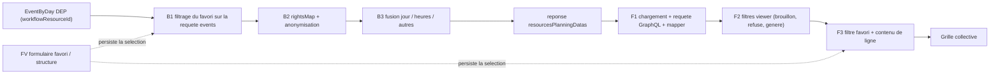

# GTA-1744 - Pourquoi l'Event DEP ne s'affiche pas dans les plannings ?

Contexte des workflows : `cronexia-suivi-2/suivi/________________workflow-context.md`

Plans d'origine : `GTA-1744-wf-events-hourly-backend.md` et `GTA-1744-wf-events-hourly-frontend.md` (même dossier).

Statut : investigation, lecture seule. Aucune modification de code tant que l'étape 7 (synthèse) n'est pas validée. Les tests et appels playground sont lancés par l'équipe, pas par l'agent.

## Constat

- Les demandes `eventByDay` (DEP, RC) s'affichent correctement dans le calendrier, les anomalies et la synthèse.
- Elles ne s'affichent pas dans le planning collectif : `cronexia-gta-front-v2/app/src/routes/(app)/(with-filters)/collective-schedule`.
- Jeu de test : Event DEP (`event_AbsenceDeplacement`, `events.seed.ts` lignes 369-390), ressource Céline Lefevre (`resource__LefevreC`), demandes d'octobre 2024 (`workflow-resource-12-celine-lefevre-event-by-day-dep.seed.ts`).

| Date | État de la demande |
|------|--------------------|
| 07/10/2024 | `draft` |
| 08/10/2024 | `pending` |
| 09/10/2024 | `validated` |
| 10/10/2024 | `refused` |
| 11/10/2024 | `cancelled` |

Chaque demande porte un seul `EventByDay` 09:00-12:00 (180 min), rattaché directement à la demande (`workflowResourceId`).

## Ce qui contraint l'affichage du planning collectif

- Favori de planning : liste dynamique choisie par l'utilisateur (ce qui est affiché).
- Droits et contraintes par event (nouveau développement d'un autre développeur, en cours) : affichage selon le rôle et les capacités.
- Possibles contraintes anciennes codées en dur.

## Chemin de la donnée (où un event peut se perdre)

## Pistes déjà identifiées (à confirmer, pas encore prouvées)

### Piste 1 - Le favori empêche de charger les `EventByDay` d'absence (la plus probable)

- `getResourcesPlanningDatas` (`cronexia-gta-back/app/src/resources/functions/planning/get-resources-planning-datas.ts`) ne charge les `EventByDay` de type `Absence` que si `allEventsAbsencesHourly` est vrai, ou si le favori liste l'event par son `name` (`resourcesSpecificEventsByNamesByPeriod`, `resourcesSpecificEventsByDaysByPeriod`).
- Le favori collectif par défaut (`planning-collective-default.recommended.seed.ts`, id `00000000-9f00-0000-0000-000000000001`) a :
  - `allEventsAbsencesDaily: true`
  - `allEventsAbsencesHourly: false`
  - `allEventsOther: true`
- Avec cette combinaison, `resourcesSpecificEventsByDaysByPeriod` ne ramène que les `EventByDay` non-Absence (plus les `EventRangeOnResource`). Les lignes `EventByDay` DEP (type `Absence`) ne sont jamais lues.
- Le repli front est cohérent avec ce choix : `COLLECTIVE_DEFAULT_PRESET` (`apply-planning-favorite.ts`) met `hourAbs: { all: false, codes: [] }` (commentaire : pas d'absences horaires, GTA-1265).

### Piste 2 - DEP est à la fois « jours » et « heures », le formulaire de favori le range côté jours

- Flags de DEP dans le seed : `isManagedByDay`, `isManagedByHalfDay`, `isManagedByDuration`, `isManagedByStartAndEndHours` tous à `true`.
- `get-planning-favorite-dynamic-structure.ts` le renvoie dans `eventsAbsencesDaily` et dans `eventsAbsencesHourly`.
- `favoriteEventGroups` (`favorite-form.ts`) dédoublonne par code et garde le premier seau : `daily`.
- `eventBucketValues` ne peut donc pas placer DEP dans le seau `hourly`, sauf si le seau entier est en « tous ».
- Conséquence : un favori personnalisé avec une liste explicite n'inclut jamais DEP dans les absences en heures, ni côté back (`absencesHourlyNames`) ni côté front (`eventFilter.hourAbs.codes`).

### Piste 3 - Double classification jours / heures dans les fusions backend

- `merge-daily-absences.ts` accepte un `EventByDay` quand `isManagedByDay` ou `isManagedByHalfDay` est vrai.
- `merge-hourly-absences.ts` l'accepte quand `isManagedByDuration` ou `isManagedByStartAndEndHours` est vrai.
- Une ligne DEP peut donc se retrouver dans `dailyAbsences` et dans `hourlyAbsences`.
- Côté front (`planning-data.mapper.ts`), la copie « jours » est regroupée par clé `${code}-${date}` (pas d'`idEventRangeOnResource`, `typeDay` à `Day`), et la copie « heures » est un bloc horaire. Chacune est ensuite filtrée par une règle de favori différente (`dayAbs` ou `hourAbs`).

### Piste 4 - Droits par event (`UserProfileEventRight`)

- `mergeDailyAbsences`, `mergeHourlyAbsences` et `mergeOtherEvents` retirent tout event sans ligne de droits (`rights?.canViewSelf === true` ou `canViewOthers === true`, selon `isSelf`).
- `user-profile-event-right.seed.ts` couvre DEP (`event_AbsenceDeplacement`) : manager `canViewSelf: false` / `canViewOthers: true`, employee `canViewSelf: true` / `canViewOthers: true`.
- Aucune entrée pour RC (`event_ReposCompensateur`) dans ce seed : RC est donc masqué pour tous les profils dès qu'une `rightsMap` est fournie.
- Une `rightsMap` vide (profil sans ligne) masque tous les events.
- RC est `isAnonymousInTeamPlanning: true` (DEP : `false`) : pour un employé qui regarde les autres, `code` et `labelShort` sont remplacés par le type, ce qui peut casser la correspondance avec le favori.
- À vérifier : le développement en cours de l'autre développeur (branche ou diff à retrouver) change-t-il la forme de la `rightsMap`, la logique `isSelf` ou ajoute-t-il d'autres contrôles ?

### Piste 5 - Filtres front sur l'état de la demande

- Brouillons des autres masqués si `IS_DISPLAY_DRAFT_REQUESTS` est faux (`filter-planning-datas-draft-for-viewer.ts`).
- Refusés et annulés masqués par la case dédiée (`filter-mapped-planning-cancelled-or-refused.ts`, appelé dans `CollectiveSchedulePage.svelte`, ligne 1794).
- `isGeneratedWithoutWorkflow` : un event `isUserInput: false` sans demande est masqué (DEP est `isUserInput: true`, donc non concerné).
- Le mapper ignore une ligne horaire si `timeStart` ou `timeEnd` ne sont pas parsables ou si `end <= start`.
- Ces filtres expliquent au mieux l'absence des lignes `draft`, `refused` et `cancelled` des seeds, pas celle de la ligne `pending` ni `validated`.

### Points de base à vérifier aussi

- Céline Lefevre appartient bien à la population sélectionnée.
- La période affichée couvre bien le 07-11/10/2024.
- Cache de période (`planning-period-cache.ts`, `prefetch-adjacent-planning-periods.ts`) : une réponse périmée n'est-elle pas servie ?

## Plan d'investigation (une conversation par étape, dans l'ordre)

Chaque étape se termine par une note de 5 lignes maximum : ce qui est confirmé, ce qui est écarté, et la preuve (fichier et ligne, ou extrait de réponse). Les notes sont ajoutées dans la section « Résultats » en bas de ce fichier.

### Étape 0 - Base de référence et matrice de bissection (sans lire de code)

Objectif : savoir quelle couche perd l'event avant de lire quoi que ce soit.

- Playground `resourcesPlanningDatas` pour `LefevreC`, période 2024-10-07 à 2024-10-11, en sélectionnant `dailyAbsences`, `hourlyAbsences`, `otherEvents` avec `workflowResource { state workflow { type } }`.
- Matrice à exécuter :
  - favori : aucun / défaut collectif / `...5f02-000000000008` (tout) / `...5f02-000000000002` (absences en heures seulement) / un favori personnalisé avec liste explicite ;
  - profil : SUPER_ADMIN, MANAGER (Murielle), EMPLOYEE (Céline).
- Vérifications de base : population, période, case « afficher annulés et refusés », config `IS_DISPLAY_DRAFT_REQUESTS`.
- Livrable : tableau « cas -> DEP dans la réponse brute ? -> DEP dans la grille ? ». La première colonne vide indique les étapes utiles parmi 1 à 6.

### Étape 1 - B1 Backend : filtrage du favori sur la requête des events / fait (lecture du code)

Fichiers :

- `get-resources-planning-datas.ts` (`shouldFetchEvents`, `eventsPromise`, branche présents / absents)
- `resources-specific-events-by-days-by-period.ts`
- `resources-specific-events-by-names-by-period.ts`
- `resources-all-events-by-days-by-period.ts`
- `format-and-merge-all-events-by-resources.ts`
- `event-by-day-workflow-resource.ts` (estampille de la demande)

Questions :

- Quelles combinaisons de flags du favori ramènent les `EventByDay` DEP ?
- Le chemin « par nom » ramène-t-il DEP quand seul `eventsAbsencesDaily` le contient ?
- L'estampille conserve-t-elle `workflowResource` pour une demande directe ?
- Le calcul présents / absents (GTA-1858) compte-t-il DEP deux fois ?

Livrable : table de vérité « flags du favori -> types d'`EventByDay` lus ».

### Étape 2 - B2 Backend : droits et anonymisation / fait (lecture du code et des seeds)

Fichiers :

- `users/functions/helpers/get-event-rights-for-user.ts`
- `resources.resolver.ts` (`resourcesPlanningDatas`, construction de `rightsMap` et du contexte)
- les blocs `if (rightsMap)` des trois fichiers de fusion
- `user-profile-event-right.seed.ts`, `helpers/seed-event-rights.helper.ts`
- `events/functions/create-default-event-rights.ts`
- `02-recommended/_recommended.orchestrator.ts`

Questions :

- DEP et RC ont-ils des lignes de droits en base de dev, pour chaque profil ?
- Que change le développement en cours de l'autre développeur ?
- Que se passe-t-il avec une `rightsMap` vide ?
- L'anonymisation fait-elle perdre le code que le favori attend ?

Livrable : tableau profil x {DEP, RC} x {`canViewSelf`, `canViewOthers`}.

### Étape 3 - B3 Backend : classification jours / heures / autres / fait (lecture du code)

Fichiers : `merge-daily-absences.ts`, `merge-hourly-absences.ts`, `merge-other-events.ts`, `compute-resource-presence-dates.ts`, `hourly-absence-event.model.ts`, `daily-absence-event.model.ts`.

Questions :

- Confirmer que DEP atterrit à la fois dans `dailyAbsences` et dans `hourlyAbsences`.
- Quels `typeDay` et `idEventRangeOnResource` porte la copie « jours » ?
- Un DEP brouillon, refusé ou annulé est-il renvoyé dans les deux listes (pas de filtre d'état, voulu) ?
- Quelle règle cible pour un event géré à la fois en jours et en heures ?

### Étape 4 - FV Formulaire de favori et structure / fait (lecture du code)

Fichiers :

- `get-planning-favorite-dynamic-structure.ts`
- `favorite-form.ts` (`favoriteEventGroups`, `eventDisplayValues`, `eventBucketValues`, constructeurs de payload)
- `FavoriteForm.svelte`
- `planning-favorites.resolver.ts` (création et mise à jour)
- routes `routes/api/planning/planning-favorite`

Questions :

- Quels seaux un favori enregistré depuis l'UI contient-il pour DEP, en mode tous / partiel / aucun ?
- À la réouverture d'un favori, DEP est-il coché ?
- Les flags `allEventsAbsencesHourly` et les listes connectées sont-ils cohérents avec ce dont la grille a besoin ?

### Étape 5 - F1 Front : chargement et mapping / fait (lecture du code)

Fichiers :

- `collective-schedule/.../+page.server.ts`
- `load-collective-planning-page.server.ts`
- `routes/api/planning/planning-data/+server.ts`
- `lib/graphql/planning/queries/resourcesPlanningDatas.ts` (jours ~126-155, heures ~166-183, autres ~214)
- `planning-data.mapper.ts` (branche heures ~759-800, autres événements ~855-905)
- `filter-planning-datas-draft-for-viewer.ts`
- `planning-period-cache.ts`, `prefetch-adjacent-planning-periods.ts`

Questions :

- La sélection GraphQL conserve-t-elle tous les champs utiles (`timeStart`, `timeEnd`, `workflowResource`) ?
- `parseHour` accepte-t-il le format d'heure renvoyé ?
- Chaque état seedé produit-il un event `hourAbs` dans la ressource mappée, avec quelle catégorie et quel `workflowStatus` ?
- Un cache périmé renvoie-t-il un ancien payload ?

### Étape 6 - F2 / F3 Front : filtres d'affichage / fait (lecture du code)

Fichiers :

- `CollectiveSchedulePage.svelte` (autour des lignes 410 et 1794)
- `CollectiveScheduleGrid.svelte` (ligne ~587)
- `apply-planning-favorite.ts`
- `planning-display-options.ts` (`eventsLineHasContent`, `resourceHasVisibleContent`)
- `is-cancelled-or-refused-event.ts`
- `filter-mapped-planning-cancelled-or-refused.ts`
- `planning-palette.helpers.ts`, `planning-resource-batch.ts`

Questions :

- Avec les bonnes données (étape 5), quel filtre retire les events `hourAbs` DEP : règle `hourAbs` ou `dayAbs` du favori, ligne vide réduite, case refusés, règle des brouillons ?
- La copie `dayAbs` (étape 3) est-elle filtrée alors que la copie `hourAbs` ne l'est pas, ou l'inverse ?

### Étape 7 - Synthèse et options de correction / fait (correctif en place)

Fusionner les notes des étapes 0 à 6 en une liste de causes triée par impact, puis proposer des options sans les implémenter :

- Classification DEP / RC : décider si un event géré en jours et en heures est affiché depuis la source heures quand la ligne est un `EventByDay`, et aligner `mergeDailyAbsences`, `mergeHourlyAbsences`, le dédoublonnage du formulaire de favori et `eventPassesFavorite` sur la même règle. Règle basée sur les propriétés de l'event, jamais sur un code en dur (`DEP`, `RC`).
- Chargement backend : faire dépendre la lecture des `EventByDay` des seaux qui couvrent réellement l'event, et pas seulement de `allEventsAbsencesHourly` ou des noms « heures ».
- Droits : ajouter RC au seed de droits (ou aux droits par défaut), en coordination avec l'autre développeur.
- Seeds, docs, et specs à ajouter (lancées par l'équipe).

Livrable : un plan d'implémentation, découpé backend / formulaire de favori / front, à valider.

## Points à trancher pendant l'étape 0

- Quel favori et quel profil étaient utilisés quand le problème est apparu (favori collectif par défaut ou liste personnalisée) ?
- Le développement des droits de l'autre développeur est-il déjà présent dans le backend local ?

## Étape 1 - Détail (B1, lecture du code)

Aucun appel playground. Les flags ci-dessous sont ceux lus dans `get-resources-planning-datas.ts` après chargement du favori. Sans favori passé à la requête, les trois flags `all*` sont forcés à vrai et le chemin est `resourcesAllEventsByDaysByPeriod` : tous les `EventByDay` de la période, DEP compris. La page collective envoie toujours un id (`COLLECTIVE_PLANNING_FAVORITE_ID` si le cookie est vide), donc ce chemin « sans favori » n'est pas celui du test.

Règle de lecture des `EventByDay` (type `Absence`, donc DEP et RC) :

- La relation `eventByDays` n'est sélectionnée que si `allEventsAbsencesHourly` ou `allEventsOther` est vrai, ou si la liste `eventsAbsencesHourly` / `eventsOther` contient au moins un nom.
- `allEventsAbsencesDaily` et la liste `eventsAbsencesDaily` ne lisent que des `EventRangeOnResource`. Un DEP présent seulement dans ce seau n'est pas lu : les seeds DEP sont des `EventByDay`, pas des plages.
- Filtre de type dans `resourcesSpecificEventsByDaysByPeriod` : heures seules → `event.type = Absence` ; autres seuls → `event.type` différent de `Absence` ; heures et autres ensemble → pas de filtre de type.
- Filtre par nom dans `resourcesSpecificEventsByNamesByPeriod` : un DEP (type `Absence`, `name` `DEP`) ne matche que `absencesHourlyNames`. La liste des noms heures n'est construite que lorsque `allEventsAbsencesHourly` est faux.

| `allDaily` | `allHourly` | `allOther` | Liste noms | `EventByDay` DEP lu ? | Chemin |
|------------|-------------|------------|------------|------------------------|--------|
| vrai | vrai | vrai | ignorées | oui | `resourcesAllEventsByDaysByPeriod` |
| vrai | faux | vrai | vides | non (filtre « pas Absence ») | favori collectif par défaut `…000001` |
| faux | vrai | faux | vides | oui (filtre Absence) | favori dev `…5f02…000002` |
| vrai | vrai | faux | vides | oui (filtre Absence) | `resourcesSpecificEventsByDaysByPeriod` |
| faux | faux | vrai | vides | non (filtre « pas Absence ») | idem |
| faux | faux | faux | DEP dans `eventsAbsencesHourly` | oui (`name` dans la liste heures) | `resourcesSpecificEventsByNamesByPeriod` |
| faux | faux | faux | DEP seulement dans `eventsAbsencesDaily` | non | la relation `eventByDays` n'est pas sélectionnée |
| faux | faux | faux | listes vides | non | `shouldFetchEvents` faux, `{ resources: [] }` |

Le favori dev `…5f02…000001` (CP, RTT en jours, VMED et DEJ en heures, flags `all*` au défaut `false`) est dans la dernière ligne utile : DEP n'est dans aucune liste de noms, donc il n'est pas lu.

Estampille : `formatAndMergeAllEventsByResources` appelle `mapEventByDayWorkflowResource` sur chaque `EventByDay` déjà lu. La clé directe (`workflowResourceId`, select `id` + `state` + `workflow.type`) est prioritaire sur la déclaration. Une demande DEP directe garde donc `workflowResource` et `workflowState` dans le tableau fusionné, avant les fusions planning. Cette estampille ne s'applique qu'aux lignes que le favori a laissé passer.

Doublon de lecture : DEP n'est pas renvoyé deux fois par la paire « par nom » + « par flags ». Quand `allHourly` est faux et `allOther` est vrai, le chemin flags ne garde que les types non Absence, et le chemin noms ne garde DEP que s'il est dans la liste heures. Les deux ensembles ne se recouvrent pas pour un event Absence.

Présents / absents (GTA-1858) : si le favori n'a pas les deux flags `allEventsAbsencesDaily` et `allEventsAbsencesHourly` (cas du favori collectif par défaut), un second appel `resourcesSpecificEventsByDaysByPeriod(true, true, false)` recharge toutes les absences, DEP compris, pour les compteurs de présence seulement. `computeResourcePresenceDates` met les dates dans un `Set` : un même jour DEP classé ensuite en jour et en heures compte une seule fois comme absent. Ce second chargement n'alimente pas `dailyAbsences` / `hourlyAbsences` de la grille.

## Étape 2 - Détail (B2, lecture du code et des seeds)

Le filtre s'applique après la lecture de l'étape 1. Avec le favori collectif par défaut, les `EventByDay` DEP n'arrivent pas jusqu'ici. Les droits ne décident que pour une ligne déjà lue (`allHourly` vrai, ou `name` dans la liste heures).

`resourcesPlanningDatas` construit toujours une `rightsMap` (`getEventRightsForUser` sur l'UPI du `supi`) et la passe aux trois fusions. Une `Map` vide est truthy : `rightsMap.get(idEvent)` vaut `undefined`, et `canViewSelf` / `canViewOthers` ne valent pas `true`. L'event est retiré. Même effet pour un event absent de la map. Le commentaire du résolveur (vers 2839) dit qu'il n'y a pas de contournement SUPER_ADMIN sur cette requête. Le catalogue `getEventsGroupedByType` (`events.resolver.ts`, vers 1737) contourne encore SUPER_ADMIN : le même profil peut voir RC dans le catalogue et pas dans le planning.

`isSelf` est vrai quand `resourceMotherId` de l'UPI sélectionnée égale `idResource` de la ligne. Sinon la fusion utilise `canViewOthers`.

Seeds (`user-profile-event-right.seed.ts`, appelé après les events dans `_recommended.orchestrator.ts`). `createManyAndReturn` du seed events n'appelle pas `createDefaultEventRights` : seules les lignes explicites existent. RC (`event_ReposCompensateur`) est le seul event du catalogue recommandé sans appel `seedEventRights`.

| Profil | DEP `canViewSelf` | DEP `canViewOthers` | RC |
|--------|-------------------|---------------------|----|
| SUPER_ADMIN | vrai | vrai | aucune ligne : masqué dans le planning |
| ADMIN | vrai | vrai | aucune ligne : masqué dans le planning |
| HR_MANAGER | vrai | vrai | aucune ligne : masqué dans le planning |
| MANAGER | faux | vrai | aucune ligne : masqué dans le planning |
| EMPLOYEE | vrai | vrai | aucune ligne : masqué dans le planning |

Effet sur la ligne de Céline, une fois la ligne lue :

- Céline en EMPLOYEE (`isSelf`) : DEP gardé (`canViewSelf`).
- Murielle en MANAGER, mère de ressource différente de Céline : DEP gardé (`canViewOthers`).
- Un MANAGER sur sa propre ligne (`isSelf`) : DEP retiré (`canViewSelf` faux).
- RC : retiré pour les cinq profils, y compris SUPER_ADMIN.

Anonymisation (`isAnonymousInTeamPlanning`, et profil `EMPLOYEE`, et ligne d'un autre) : DEP est à `false`, le code reste `DEP`. RC est à `true` : le code et le libellé deviendraient le type `Absence`, et un favori en liste explicite sur le code `RC` ne matcherait plus. Ce cas n'est pas atteint tant que la ligne RC est retirée par l'absence de droits.

Le rechargement présents / absents passe par les mêmes fusions et la même `rightsMap`. Un DEP autorisé par les droits peut compter comme absent alors que la grille ne l'a pas chargé (étape 1). Un RC ne compte pas : la fusion le retire.

Le développement des droits est déjà branché sur le planning (chargement dans `users.service.ts`, map, trois fusions, structure des favoris). L'écart encore ouvert dans cet arbre : pas de contournement SUPER_ADMIN sur `resourcesPlanningDatas`, et RC absent du seed de droits.

## Étape 3 - Détail (B3, lecture du code)

Les trois fusions parcourent le même tableau `eventByDays` déjà filtré par le favori (étape 1) et par les droits (étape 2). Elles ne relisent pas les flags du favori. Aucune des trois ne filtre `workflowState`.

DEP (`type` Absence, `name` DEP, les quatre flags `isManagedByDay`, `isManagedByHalfDay`, `isManagedByDuration`, `isManagedByStartAndEndHours` à vrai) :

| Fusion | DEP `EventByDay` | Raison |
|--------|------------------|--------|
| `mergeDailyAbsences` | oui | `type === 'EventByDay'` et `isManagedByDay` |
| `mergeHourlyAbsences` | oui | `type === 'EventByDay'` et `isManagedByDuration` ou `isManagedByStartAndEndHours` |
| `mergeOtherEvents` | non | garde les types autres qu'Absence, plus le nom `DEJ` |

Dès que l'étape 1 a lu la ligne, la réponse contient donc deux copies. Le favori « absences en heures uniquement » (`allHourly` vrai, `allDaily` faux) produit les deux copies quand même : le retrait du bloc jour est ensuite le filtre front `dayAbs`, pas cette fusion.

Copie jours (`dailyAbsences.dates[].eventRangeByDays`), après `formatAndMergeAllEventsByResources` qui pose `idEventRangeOnResource` et `typeDay` à `null` sur un vrai `EventByDay` :

- `idEventRangeOnResource` : `null`
- `typeDay` : `'Day'` (`typeDay || 'Day'` dans `merge-daily-absences.ts`)
- `erorOriginalDateStart` / `erorOriginalDateEnd` / `erorOriginalTypeDayStart` / `erorOriginalTypeDayEnd` : `null`
- pas de `timeStart` ni `timeEnd` (absents de `DailyAbsenceEventModel`)
- `status` : `workflowState`, ou `'validated'` si l'estampille est vide
- `workflowResource` : estampille complète dans l'objet fusionné ; la requête front `resourcesPlanningDatas.ts` ne sélectionne que `workflowResource { state }` sur cette copie

Copie heures (`hourlyAbsences.dates[].eventByDays`) : `idEventByDay`, `timeStart` 09:00, `timeEnd` 12:00, `duration` 180, `workflowState`, et `workflowResource { idWorkflowResource state workflow { type } }` (sélection front complète).

Les cinq états seedés (`draft`, `pending`, `validated`, `refused`, `cancelled`) sont copiés dans les deux listes. Le masquage brouillon / refusé / annulé est front (étapes 5 et 6).

Présents / absents : les deux copies alimentent `computeResourcePresenceDates`, qui range les dates dans un `Set`. Un jour DEP compte une fois.

La requête front actuelle ne sélectionne pas `erorOriginalTypeDayStart` ni `erorOriginalTypeDayEnd`. Ces champs sont non nullables sur `DailyAbsenceEventModel` et valent `null` pour un `EventByDay`. Les ajouter à la sélection ferait échouer `resourcesPlanningDatas`.

Règle actuelle : un event géré à la fois en jours et en heures est dupliqué, et la copie jours perd le créneau (journée entière, `typeDay` `Day`). Règle à trancher à l'étape 7, sans changement ici : une ligne `EventByDay` (heures ou durée) reste dans `hourlyAbsences` ; `dailyAbsences` ne garde que les `EventRangeOnResource`.

## Étape 4 - Détail (FV, lecture du code)

La requête du formulaire, `planningFavoriteDynamicStructure`, est appelée sans argument `user`. Le catalogue complet revient, filtré par `canViewSelf || canViewOthers`. DEP est dans `eventsAbsencesDaily` (`isManagedByDay`) et dans `eventsAbsencesHourly` (durée ou heures). RC n'est dans aucune des deux listes : pas de ligne de droits (étape 2). Les events `isUserInput: false` (ADEC, AINJ, AN) sont retirés de l'affichage du formulaire (`isFavoriteFilterEvent`).

`favoriteEventGroups` affiche par type (Absences / Présences / Neutres) et dédoublonne par code. L'ordre est jours, puis heures, puis autres. DEP est gardé avec `group: 'daily'`. La copie heures est ignorée. Les absences seulement en heures restent en `group: 'hourly'` : DEL et VMED (RC est déjà absent de la structure).

`FavoriteForm.svelte` affiche ces groupes. Chaque changement repasse par `eventBucketValues`, qui range le code dans le seau de ce `group`. DEP coché alimente `eventsAbsencesDaily`, jamais `eventsAbsencesHourly`. Le create et l'update (`buildCreateFavoriteParams`, `buildUpdateFavoriteParams`) persistent ce seau. Le résolveur n'a pas de second classement.

| Geste dans « Absences » | DEP persisté | `allHourly` | `EventByDay` DEP lu par la grille (étape 1) |
|-------------------------|--------------|-------------|-----------------------------------------------|
| Tous | seau jours en « tous » (`allEventsAbsencesDaily`) | vrai, parce que DEL et VMED remplissent le seau heures | oui, puis double copie (étape 3) |
| DEP seul | `eventsAbsencesDaily` connect `DEP` | faux, liste heures vide | non |
| DEP décoché | absent des deux seaux | faux si rien d'autre en heures | non |

Réouverture : `eventDisplayValues` coche un code si son seau le couvre. Le favori collectif par défaut a `allEventsAbsencesDaily: true` et `allEventsAbsencesHourly: false`. DEP s'affiche coché (seau jours « tous »). DEL et VMED restent décochés, donc le groupe Absences n'est pas « Tous ». L'écran dit que DEP est affiché. La grille ne charge pas ses `EventByDay`.

Enregistrer ce favori sans toucher aux events conserve `allDaily` vrai et `allHourly` faux. Cocher seulement DEP, ou le laisser coché par le « tous » jours, écrit DEP dans le seau jours. L'étape 1 ne lit toujours pas la ligne.

Si la config `IS_PLANNING_FILTERS_DISPLAYED__EVENTS_ABSENCES_HOURLY` est fausse, `sanitizeFavoriteFormState` vide le seau heures à l'enregistrement. DEP reste visible dans le formulaire (groupe jours) et reste enregistré uniquement en jours.

Les raccourcis exigent `canInputDirect`. DEP l'a pour SUPER_ADMIN, ADMIN et HR_MANAGER, pas pour MANAGER ni EMPLOYEE. Cela ne change pas la grille.

## Étape 5 - Détail (F1, lecture du code)

`+page.server.ts` envoie l'id du favori (cookie, sinon `00000000-9f00-0000-0000-000000000001`) à `/api/planning/planning-data`, qui appelle `resourcesPlanningDatas`. `mapPlanningResponse` dans `+page.svelte` mappe la réponse. Le favori passé au mapper sert aux compteurs. Il ne retire pas les events : ce filtre est dans la grille (étape 6). Avec le favori par défaut, les listes DEP sont déjà vides avant ce mapper (étape 1).

La sélection `resourcesPlanningDatas.ts` couvre ce que le mapper lit, quand la ligne est présente :

- Heures : `idEventByDay`, `timeStart`, `timeEnd`, `isUserInput`, `workflowState`, `workflowResource { idWorkflowResource state workflow { type } }`.
- Jours : `idEventRangeOnResource`, `typeDay`, `status`, `workflowResource { state }`. Pas d'heures, pas de `workflow.type`.

`parseHour` (`/^(\d{1,2}):(\d{2})/`) accepte le `GraphQLTime` `09:00:00.000Z` (scalar, ou `convertToGraphQLTime`). Le seed 09:00-12:00 UTC donne `end > start`. La branche heures ne saute pas cette ligne. `isGeneratedWithoutWorkflow` non plus : DEP a `isUserInput: true`.

Si les deux copies sont dans le JSON, `mapPlanningData` produit :

| État seed | Copie heures | Copie jours |
|-----------|--------------|-------------|
| `draft` | `hourAbs`, statut Draft | `dayAbs` journée (`typeDay` Day), statut Draft |
| `pending` | `hourAbs`, Pending | `dayAbs` journée, Pending |
| `validated` | `hourAbs`, Validated | `dayAbs` journée, Validated |
| `refused` | `hourAbs`, Refused | `dayAbs` journée, Refused |
| `cancelled` | `hourAbs`, Cancelled | `dayAbs` journée, Cancelled |

Le statut vient de `workflowResource.state` (`mapWorkflowResourceStateToPlanningStatus`). DEP n'est ni télétravail ni astreinte : catégorie `hourAbs` ou `dayAbs`, pas `remoteAstrinte`.

`mapPlanningData` appelle `filterPlanningDatasDraftForViewer` parce que la page passe le viewer. Un brouillon d'une autre ressource est retiré des deux listes quand `IS_DISPLAY_DRAFT_REQUESTS` est faux. Le brouillon de la ressource connectée reste. `pending`, `validated`, `refused` et `cancelled` restent dans l'objet mappé. Le retrait des refusés et annulés est l'étape 6.

La colonne utilise `colOfDate.get(date)` avec des clés `YYYY-MM-DD`. `GraphQLDate` renvoie ce format (même chemin que les absences en jours déjà visibles). Une date ISO complète manquerait la colonne pour tous les events, pas seulement DEP.

Le cache (`planning-period-cache.ts`) a pour clé population, ressource, dates et id de favori. Un autre favori ne réutilise pas la grille. Le préchargement voisin passe par le même mapper et le même viewer. Un chargement frais du favori par défaut retrouve une réponse sans `EventByDay` DEP. Le cache ne crée pas cette absence.

## Étape 6 - Détail (F2 / F3, lecture du code)

`applyPlanningFavorite(selectedFavorite)` construit `eventFilter`. La grille (`CollectiveScheduleGrid.svelte`, boucle vers 1864) saute un event quand `eventPassesFavorite` est faux pour sa catégorie. L'event reste dans les données. Il n'est pas peint.

Favori collectif par défaut, et le repli `COLLECTIVE_DEFAULT_PRESET` si aucun favori n'est résolu : `dayAbs` tout, `hourAbs` rien (`all: false`, `codes: []`), `otherEvents` tout.

| Copie mappée (étape 5) | Règle | Peinte avec le favori par défaut |
|------------------------|-------|-----------------------------------|
| `hourAbs` DEP 09:00-12:00 | `hourAbs` | non |
| `dayAbs` DEP journée | `dayAbs` tout | oui |

Aujourd'hui les deux copies manquent avant ce filtre (étape 1). Si la lecture était corrigée sans changer le favori, la grille montrerait le bloc journée, pas le créneau. Le geste « Tous » les absences met les deux règles à « tout » : les deux blocs seraient peints. « DEP seul » laisse `hourAbs` vide et met `DEP` dans `dayAbs` : le créneau resterait masqué, le bloc journée passerait, à condition que la ligne ait été lue.

`filterMappedPlanningCancelledOrRefused` (`CollectiveSchedulePage.svelte`, vers 1792) retire `refused` et `cancelled` des deux copies quand la case est décochée. La préférence vaut `true` sans cookie (`show-cancelled-or-refused-events.state.svelte.ts`) : les deux états restent visibles. `pending` et `validated` ne passent pas par ce filtre. Le brouillon des autres est déjà retiré à l'étape 5. Le filtre équipe (`isTeamPlanningEventVisibleForViewer`) ne tourne qu'en mode équipe.

« Masquer les lignes vides » est faux par défaut (`cx_planning_hide_empty_rows`). `eventsLineHasContent` réutilise `eventPassesFavorite` : un `hourAbs` rejeté ne remplit pas la ligne. La ligne events du favori par défaut reste ouverte grâce aux absences en jours. `planning-resource-batch.ts` ne filtre pas les events.

La palette classe DEP en `dayAbs` (`isManagedByDay` prioritaire sur les heures, `planning-palette.helpers.ts`). Avec le favori par défaut, DEP peut être proposé au dépôt comme une absence en jours. Les lignes seedées, elles, ne sont pas dans la réponse.

## Étape 7 - Synthèse

Lecture du code seulement. L'étape 0 (playground) reste le contrôle sur la base seedée. Le développement des droits est déjà dans `resourcesPlanningDatas` (étape 2).

### Causes, par impact

1. **Lecture (favori par défaut et « DEP seul »).** Les seeds DEP sont des `EventByDay`. La grille ne les charge que si `allEventsAbsencesHourly` est vrai ou si `DEP` est dans `eventsAbsencesHourly`. Le favori collectif par défaut a le seau jours en « tous » et le seau heures vide. Le formulaire montre pourtant DEP coché, parce qu'il le range dans le seau jours. « DEP seul » enregistre la même chose. `pending` et `validated` manquent pour cette raison. Le cache, le mapper, `parseHour` et la sélection GraphQL ne retirent pas la ligne.

2. **Décalage peinture / lecture, si on ne corrige que la lecture.** Une ligne lue est copiée en `dailyAbsences` (journée, `typeDay` `Day`, sans heures) et en `hourlyAbsences` (09:00-12:00). Le favori par défaut peint le bloc journée et masque le créneau (`hourAbs` vide, `dayAbs` tout). Corriger seulement le chargement afficherait DEP en journée entière.

3. **RC, à part.** Aucune ligne `UserProfileEventRight`. Les trois fusions le retirent pour tous les profils, SUPER_ADMIN compris. Il n'apparaît pas dans le formulaire. `isManagedByDay` est faux : le seau jours ne le couvre pas. Le seed de droits et le seau heures sont les deux conditions.

4. **États, déjà conformes aux règles existantes.** Brouillon d'un autre masqué si `IS_DISPLAY_DRAFT_REQUESTS` est faux (le sien reste). Case « annulés et refusés » cochée par défaut : `refused` et `cancelled` restent. `pending` et `validated` ne sont pas concernés. Lignes vides affichées par défaut. Le filtre équipe ne s'applique pas au collectif.

Après correction de 1 et 2, sur la ligne de Céline en octobre 2024 : 08 et 09 visibles, 10 et 11 visibles tant que la case reste cochée, 07 visible pour Céline et masqué pour Murielle si les brouillons des autres sont désactivés.

### Règle proposée

La forme de la ligne décide l'affichage. Pas le code `DEP` ou `RC`.

- Une ligne `EventByDay` (durée ou heures de début et de fin) est une absence en heures : créneau, estampille complète.
- Une ligne `EventRangeOnResource` est une absence en jours.
- Un event géré à la fois en jours et en heures (DEP : les quatre flags vrais) reste coché avec les absences en jours dans le formulaire. Sa ligne `EventByDay` est quand même lue et peinte en créneau. Un event seulement en heures (DEL, VMED, RC) continue de dépendre du seau heures. Le favori par défaut (GTA-1265, pas d'absences en heures) ne se met pas à tout afficher.

### Options écartées pour le défaut

- **Laisser GTA-1265 strict.** Ranger DEP dans le seau heures du formulaire. Le favori par défaut le montrerait décoché, et la grille resterait vide tant qu'on n'active pas les heures. Le test actuel (case cochée, rien à l'écran) deviendrait cohérent, sans afficher les seeds.
- **`allEventsAbsencesHourly: true` sur le favori par défaut.** Affiche toutes les absences en heures, pas seulement les events mixtes.

### Plan d'implémentation (en place)

**Backend**

- `resourcesSpecificEventsByDaysByPeriod` / `get-resources-planning-datas` : lire les `EventByDay` d'un event couvert par le seau jours quand il est aussi géré par durée ou par heures de début et de fin. Le seau heures continue de les lire comme aujourd'hui.
- `mergeDailyAbsences` : ne garder que les `EventRangeOnResource`.
- `mergeHourlyAbsences` : garder les `EventByDay` d'absence gérés par durée ou par heures.
- Présents / absents : un jour DEP compte une fois (déjà le cas via le `Set`).
- Seed `user-profile-event-right` : ajouter RC sur le modèle DEP (employé : voir soi et les autres, saisie par demande ; manager : voir les autres). À caler avec l'autre développement des droits. Pas de contournement SUPER_ADMIN ajouté sur le planning.

**Formulaire de favori**

- `favoriteEventGroups` : un event mixte reste dans le groupe affiché Absences, seau interne jours, pour que « DEP seul » et le favori par défaut continuent de le cocher.
- Le payload ne change pas : DEP reste dans `eventsAbsencesDaily`. C'est la lecture backend qui honore ce seau pour les `EventByDay` mixtes.
- RC apparaît dans le formulaire une fois les droits seedés, dans le seau heures (`isManagedByDay` faux).

**Front grille**

- `eventPassesFavorite` : un `hourAbs` passe aussi quand la règle `dayAbs` couvre son code et que l'event est géré en jours (ou en demi-journée) en plus des heures. DEL et VMED, seulement en heures, restent masqués par le favori par défaut.
- Pas de changement du mapper, du cache, de la case refusés, ni du filtre brouillon.

**Specs (lancées par l'équipe)**

- Favori `allDaily` vrai, `allHourly` faux : un `EventByDay` dont l'event a `isManagedByDay` et `isManagedByStartAndEndHours` est lu. Un event seulement en heures ne l'est pas.
- `mergeDailyAbsences` ignore cet `EventByDay`. `mergeHourlyAbsences` le garde, avec `timeStart` / `timeEnd`.
- `eventPassesFavorite` : ce `hourAbs` passe avec `dayAbs` tout et `hourAbs` vide. Un code seulement heures ne passe pas.
- Seed RC : cinq profils ont une ligne de droits.

## Résultats

Étape 0 : à faire (playground). Le code dit déjà que le favori collectif par défaut ne lit pas les `EventByDay` DEP.

Étape 1 : confirmé. Avec le favori collectif par défaut (`allHourly` faux, `allOther` vrai), les `EventByDay` de type Absence, dont DEP, sont exclus de la requête grille (`resources-specific-events-by-days-by-period.ts`, branche `type` différent de `Absence`). DEP n'est lu que si `allHourly` est vrai, ou si son `name` est dans `eventsAbsencesHourly`. Le seau jours ne lit pas ces lignes. L'estampille directe est conservée sur les lignes lues. Les compteurs présents / absents rechargent DEP à part et ne doublonnent pas le jour. Droits et classification jour / heures : étapes 2 et 3.

Étape 2 : les droits n'expliquent pas l'absence de DEP avec le favori par défaut (la ligne n'est pas lue, étape 1). Une fois lue, DEP est visible pour Céline (EMPLOYEE, `canViewSelf`) et pour Murielle sur la ligne de Céline (MANAGER, `canViewOthers`). RC n'a aucune ligne `UserProfileEventRight` : les trois fusions le retirent pour tous les profils, SUPER_ADMIN compris (pas de contournement sur `resourcesPlanningDatas`). DEP n'est pas anonymisé.

Étape 3 : confirmé dès que la ligne est lue. DEP va dans `dailyAbsences` et dans `hourlyAbsences`, pas dans `otherEvents`. La copie jours a `idEventRangeOnResource` null et `typeDay` `Day`, sans heures. La copie heures garde 09:00-12:00 et l'estampille. Les cinq états sont renvoyés. Le favori par défaut n'atteint pas cette étape (ligne non lue).

Étape 4 : confirmé. Le formulaire range DEP dans le seau jours. Le favori par défaut le montre coché (`allDaily`) sans `allHourly` ni `DEP` dans la liste heures : la grille ne lit pas les `EventByDay`. « DEP seul » enregistre la même impasse. « Tous » les absences met `allHourly` à vrai (via DEL et VMED) et la ligne est alors lue. RC n'apparaît pas dans le formulaire.

Étape 5 : le mapper n'enlève pas DEP. S'il est dans le JSON, la copie heures devient un `hourAbs` 09:00-12:00 (les cinq états, brouillon des autres retiré) et la copie jours un `dayAbs` journée entière. La sélection GraphQL et `parseHour` gardent le créneau. Le cache suit le favori : il répète l'absence du favori par défaut, il ne la crée pas. Le filtre par code du favori est l'étape 6.

Étape 6 : avec le favori par défaut, la règle `hourAbs` masque le créneau DEP et la règle `dayAbs` laisserait passer le bloc journée. Les deux copies sont absentes avant ça (étape 1). La case refusés est affichée par défaut : `pending` et `validated` ne sont pas retirés ici. Les lignes vides sont affichées par défaut.

Étape 7 : cause principale, la lecture. Le favori par défaut coche DEP côté jours et ne charge pas les `EventByDay`. Corriger seulement la lecture montrerait une journée entière. Correctif en place : un `EventByDay` mixte (jours ou demi-journée, et durée ou début/fin) est lu avec le seau jours, fusionné seulement en heures, et la grille `hourAbs` le laisse passer quand la règle `dayAbs` couvre son code. DEL, VMED et RC restent hors du favori par défaut. RC a maintenant les mêmes droits que DEP. Specs à lancer côté équipe.
