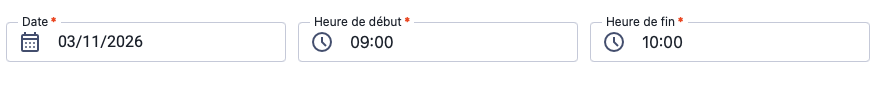

# GTA-1744 - Retour PO : créneau seul / ✅ Terminé

Contexte : `cronexia-suivi-2/suivi/GTA-1744-wf-events-hourly/` (plans 01 backend, 02 frontend).

Branche des retours : `feat-1744-wf-events-hourly-returns`.

Le mode durée se commente. Il ne se supprime pas : une réactivation plus tard doit pouvoir le remettre en service en décommentant le front. Le serveur et les colonnes d'affichage ne bougent pas.

## Retour PO

Supprimer le choix créneau / durée. Ne garder que le créneau, et réutiliser l'existant.

Visuel cible : 

Trois champs outlined sur une ligne : Date (icône calendrier), Heure de début (horloge), Heure de fin (horloge), astérisque requis.

## Où c'est aujourd'hui

- Création : `cronexia-gta-front-v2/app/src/routes/components/cronexia/workflow/HourlyEventWorkflowModal.svelte`. `InputDate` « Date » seul, puis la bascule `slot` | `duration`, puis soit deux `InputTime` « Début » / « Fin », soit un `InputTime` en `mode="duration"`. `save` vide les heures en mode durée, ou parse la durée en mode créneau.
- Le visuel n'est pas `InputDateAndTimeSlot.svelte` (`routes/components/common/form/date/`). Ce composant est un seul champ « Plage horaire » (date et heures dedans, flèche `→`), utilisé dans le tableau d'absences en heures. La capture, c'est la rangée déjà en place dans `routes/components/cronexia/event/create/EventCreateModal.svelte` (mode heures, vers les lignes 399–420) : `InputDate` « Date », `InputTime` « Heure de début », `InputTime` « Heure de fin », dans une grille `repeat(auto-fit, minmax(11rem, 1fr))`. Mêmes composants que la modale workflow. Pas un nouveau sélecteur.
- Validation et payload : `routes/functions/cronexia/workflow/hourly-event-workflow-create.helpers.ts`. Une ligne part soit avec `timeStart` / `timeEnd`, soit avec `duration` en minutes. Les deux ensemble, ou aucun des deux, est refusé (« Indiquez un créneau ou une durée »). Spec : `hourly-event-workflow-create.helpers.spec.ts`.
- Affichage, à part : la famille `hourlyEvent` a une colonne durée (`routes/functions/cronexia/workflow-tab/families/hourly-event.family.ts`). Le détail aussi (`demand-details/WorkflowHourlyEventLines.svelte` : Date, Créneau, Durée). `resolve-hourly-display.ts` peint un créneau si début / fin sont là, sinon une durée. Ce n'est pas le choix de saisie.
- Serveur : `cronexia-gta-back/app/src/event-by-days/functions/service/validate-event-by-day-input.ts`. DEP est géré à la fois par durée et par début / fin, donc une ligne avec seulement `duration` est acceptée.

## Modale

Fichier : `HourlyEventWorkflowModal.svelte`.

Commenter, ne pas supprimer. Marqueur `// * GTA-1744 — durée commentée, décommenter pour réactiver` :

- `mode`, `durationText`, `setMode` ;
- la bascule Créneau / Durée et le champ durée ;
- le ternaire de `save` qui vide les heures ou appelle `parseHourlyEventDurationMinutes`.

Rangée active, calquée sur `EventCreateModal` (classe grille du même type que `.ec-hours`) :

- `InputDate` « Date », `InputTime` « Heure de début », `InputTime` « Heure de fin », tous `isRequired`.
- `save` envoie toujours `timeStart`, `timeEnd`, et `durationMinutes: null`.

La modale reste en taille `M` (40rem). Trois colonnes d'environ 11rem tiennent ; plus étroit, la grille passe à la ligne, comme à la création d'événement.

Les messages sous la rangée restent (`validationErrors.date`, `.timeStart`, `.timeEnd`). Pas de bordure d'erreur nouvelle : `InputTime` n'en a pas.

## Validation et payload

Fichier : `hourly-event-workflow-create.helpers.ts`.

Commenter les branches, sans retirer les symboles (`BOTH_MODES`, `NEITHER_MODE`, `DURATION_MINUTES`, `hasDuration`, `parseHourlyEventDurationMinutes`, le champ `duration` des types) :

- dans `validateHourlyEventCreateDraft`, les retours « les deux », « aucun des deux », et « durée seule » ;
- dans `resolveHourlyEventCreateLine`, le retour `{ date, duration }` ;
- dans `buildHourlyEventWorkflowCreateParams`, la branche qui n'envoie que `duration`.

Chemin actif : date requise et calendaire, début et fin requis au format `hh:mm`, fin strictement après début (`END_AFTER_START`). Heures vides : « L'heure de début est requise. » / « L'heure de fin est requise. ». Plus de « Indiquez un créneau ou une durée ». Une ligne sans heures ne sort plus.

## Specs

Fichier : `hourly-event-workflow-create.helpers.spec.ts`. Lancé par l'équipe, pas par l'agent.

Commenter :

- le cas « construit une durée en minutes… » ;
- l'assertion durée nulle ;
- les expects « pas les deux » et « Indiquez un créneau ou une durée ».

Laisser actifs : créneau `09:00`–`12:30`, pending, `24:00` → `23:59:59Z`, fin pas après début, format invalide, date vide ou invalide, et `parseHourlyEventDurationMinutes` (fonction conservée).

Cas heures vides : début et fin requis, à la place du message « ou ».

## Inchangé

- Serveur `validate-event-by-day-input.ts` : une durée seule reste acceptée, pour qu'un décommentage front suffise.
- Affichage : `hourly-event.family.ts`, `WorkflowHourlyEventLines.svelte`, `resolve-hourly-display.ts`. Les colonnes durée décrivent un créneau déjà saisi, ou une ligne ancienne sans heures.
- Widgets collab (note 08), bouton déplacement (note 09), modalité (note 05), message horaire de repos (note 06).
