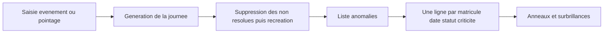
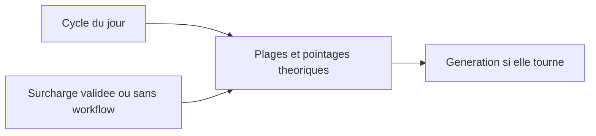
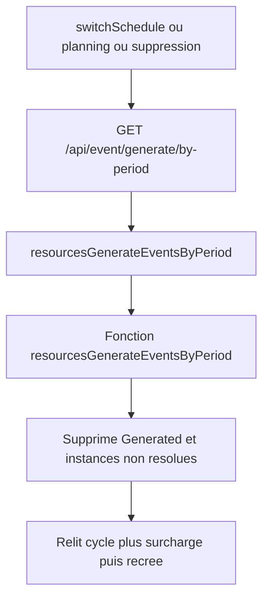

# GTA-1754 / Conflits d'anomalies — détection et affichage

Résumé d'investigation. Pas de correctif ici. Les problèmes 1 à 4 sont corrigés. Les problèmes 5 à 8 portent sur l'horaire du jour et la surcharge.

## Contexte

Un **cycle** est affecté à la ressource et déroule, jour par jour, un **horaire**. L'horaire du jour est une suite de plages (`ScheduleShiftDetail`) : présence attendue, absence attendue, pause. Chaque plage indique quel événement générer si la personne est absente ou présente, et si cet événement est une anomalie.

Un **pointage** est une entrée ou une sortie. La génération alterne absent / présent à chaque pointage. `timeValidated` prime sur `timeReal`.

Un **événement** est une saisie manuelle, de type Absence, Présence (exemple : HSUP) ou Neutre. Il est stocké à l'heure (`EventByDay`) ou à la journée / demi-journée (`EventRangeOnResource`, exemple : Délégation). Les neutres sont dans une pile à part : ils ne corrigent ni une absence injustifiée ni une présence non autorisée.

La **génération** parcourt la journée instant par instant et compare l'horaire, les pointages et les saisies. Elle réécrit les `EventByDay` d'origine `Generated`, puis les instances d'anomalie non résolues.

Deux familles d'anomalies :

- **Écart horaire / réel.** ABSINJ : la personne devrait être là et ne l'est pas. Une saisie Absence sur le créneau la résout. PNA (présence non autorisée) : elle est là alors que l'horaire dit absent. Une saisie Présence la résout.
- **Conflit**, qui ne remplace pas l'écart ci-dessus. `CONFLIMLTP` : deux absences ou deux présences se chevauchent. `CONFLIMLTPNEUTRE` : deux neutres du même type. `CONFLIEXCL` : le pointage contredit la saisie. `CONFLIOVRL` : une présence ou absence normale chevauche une saisie de même attendance.

La page anomalies ne recalcule pas ces chevauchements. Elle dessine les plages des instances (`start` / `end`, et `startNeutral` pour un conflit neutre). Une illustration qui reste après un ajout, un retrait ou un ré-ajout est une instance encore `À traiter`, fusionnée avec les autres du même jour.

Le conflit entre saisies reste, et l'ABSINJ ou la PNA est résolue dès qu'une saisie du bon type couvre le créneau, même s'il y en a plusieurs (problème 2, corrigé).

Contexte technique : un correctif d'affichage sur la page anomalies doit aussi être porté sur la page synthèse, @cronexia-gta-front-v2/app/src/routes/(app)/(with-filters)/summary.

## Problème 1 — un chevauchement qui change de composition garde l'ancienne fin / ✅ Corrigé

Fichiers :

- @cronexia-gta-back/app/src/resources/functions/events/generate/resources-generate-events-query-by-period.ts vers 1431-1515
- @cronexia-gta-back/app/src/resources/functions/events/generate/functions/create-partial-anomaly-instance-to-generate.ts vers 109-117
- @cronexia-gta-back/app/src/resources/functions/events/generate/functions/close-anomaly-instance-to-generate.ts

Tant que deux saisies manuelles (absence ou présence) sont en pile, un conflit `CONFLIMLTP` est ouvert. Son `timeEnd` est pré-rempli avec la fin du dernier événement de la pile. Quand un autre événement entre et que le hash change, la clôture calcule la vraie fin, puis le bloc vers 1509-1511 remet `timeEnd` à cette fin d'origine. L'instance stockée couvre encore l'ancienne plage. La nouvelle composition ouvre une seconde instance. Les deux plages sont dessinées.

Le hash (vers 1440-1442) distingue les événements par `eventCode` + heures + un id. @cronexia-gta-back/app/src/resources/functions/events/generate/functions/add-manual-event-to-pile.ts vers 79-90 met l'id du catalogue (`eventId`) dans `idEventByDay` / `idEventRangeByDay`, à la place de l'id de la ligne. Deux saisies du même événement aux mêmes heures produisent le même hash : le conflit n'est pas reclôturé quand on retire puis ré-ajoute.

## Problème 2 — ABSINJ / présence non autorisée ignorées dès qu'il y a plusieurs saisies / ✅ Corrigé

Fichier : @cronexia-gta-back/app/src/resources/functions/events/generate/resources-generate-events-query-by-period.ts vers 2322-2337 et 2491-2720.

La résolution d'une anomalie horaire par une saisie manuelle (Délégation qui couvre une ABSINJ, même attendance) ne tourne que si `currentManualEvents.length === 1`. Dès qu'une deuxième absence ou présence est dans la pile, l'anomalie horaire n'est pas découpée et part en `À traiter` sur toute la plage, en plus du conflit de chevauchement. Retirer puis ré-ajouter maintient souvent la pile à 2 ou plus, donc l'illustration reste.

Les événements neutres sont dans une autre pile (`currentManualEventsNeutral`) et ne comptent pas dans ce test.

## Problème 3 — une résolution partielle reste « à traiter » / ✅ Corrigé

Même fichier, vers 2577-2663, et @cronexia-gta-back/app/src/resources/functions/events/generate/functions/create-anomaly-instance-to-generate.ts.

Avant correctif, seule la résolution complète posait `status = treated`. Les morceaux « RESOLUE PARTIELLEMENT » étaient créés sans statut : @cronexia-gta-back/app/src/anomaly-instances/functions/service/validate-or-set-anomaly-instance-status.ts leur donnait `toBeTreated` si la criticité est une erreur. La page ne masque la surbrillance que pour le libellé `Traité` (@cronexia-gta-front-v2/app/src/routes/components/cronexia/anomaly/AnomaliesArrayTr.svelte vers 127-128). Ces morceaux restaient donc dessinés.

Correctif (2e passe, problème 10) : les morceaux partiels et la résolution complète sont émis par le même helper, @cronexia-gta-back/app/src/resources/functions/events/generate/functions/build-resolved-anomaly-instance.ts. La ligne complète (`RESOLUE …`, `treated`) est écrite aussi hors logs. Avant, elle était dans un bloc `displayLogs` depuis le commit `b648653d`. Tests manuels pas lancés.

@cronexia-gta-back/app/src/resources/functions/events/generate/functions/compare-anomaly-instances.ts identifie une instance par date, heures, `anomalyId` et ressource. La description n'entre pas en compte. Une plage dont les heures n'ont pas changé n'est pas basculée en traitée par @cronexia-gta-back/app/src/resources/functions/events/generate/resources-generate-events-by-period.ts vers 374-441. Ce fichier supprime bien toutes les non résolues puis recrée la génération courante (vers 483-530). Il ne conserve pas l'ancienne ligne. Si l'illustration reste, c'est que la génération l'a réémise en `À traiter`.

@cronexia-gta-back/app/src/resources/functions/events/generate/resources-delete-generate-events-by-period.ts ne supprime que les `EventByDay` d'origine `Generated`. Les instances d'anomalies sont gérées dans le fichier de génération.

## Problème 4 — la page dessine toutes les plages du jour sur une seule ligne / ✅ Corrigé

Fichiers :

- @cronexia-gta-front-v2/app/src/routes/functions/cronexia/anomaly/transform-anomalies.ts vers 22 (`uniqueId` = matricule + date + statut + criticité)
- @cronexia-gta-front-v2/app/src/routes/functions/cronexia/anomaly/aggregate-anomalies.ts vers 50-87 (`CONFLIMLTPNEUTRE` non traité vers `startNeutral`, le reste vers `start` / `end`)
- @cronexia-gta-front-v2/app/src/routes/components/cronexia/anomaly/AnomalyDayTimeline.svelte vers 138-167 (anneaux dès qu'un libellé contient « Conflit » et « chevauchement », sur chaque plage de la ligne)
- @cronexia-gta-front-v2/app/src/routes/(app)/(with-filters)/anomalies/population/[[population]]/resource/[[resource]]/dateStart/[[dateStart]]/dateEnd/[[dateEnd]]/+page.svelte vers 67-81

Une ABSINJ et un chevauchement encore `À traiter` le même jour deviennent une seule ligne. Toutes leurs plages sont illustrées ensemble. Corriger l'une ne retire l'anneau de l'autre que si l'instance disparaît de la liste, ou passe `Traité` (alors masquée s'il reste un `À traiter` sur le jour, `hideTreatedWhenUnresolved`).

Le rechargement est branché : pointage et événement horaire passent par les actions de @cronexia-gta-front-v2/app/src/routes/(app)/(with-filters)/anomalies/population/[[population]]/resource/[[resource]]/dateStart/[[dateStart]]/dateEnd/[[dateEnd]]/+page.server.ts, qui attendent la génération puis renvoient `updatedAnomalies`. L'événement en jours passe par `callRangeApi` dans @cronexia-gta-front-v2/app/src/routes/components/common/accordion/DayTimelineAccordion.svelte vers 319-345 (`invalidateAll`, puis rechargement de la ligne). Le garde-fou GTA-1753 dans @cronexia-gta-front-v2/app/src/routes/functions/cronexia/anomaly/updated-anomalies-override.ts garde la liste de l'action tant que l'objet du loader n'a pas changé. Ce mécanisme explique un affichage figé seulement si le loader ne repasse pas. Les plages fausses après plusieurs allers-retours correspondent aux instances des problèmes 1 à 3.

## Pointages

@cronexia-gta-back/app/src/resources/functions/events/times/resources-even-clockings-by-period.ts vers 213-255 prend `timeValidated` quand il est renseigné, sinon `timeReal`. @cronexia-gta-front-v2/app/src/routes/functions/cronexia/anomaly/form/action/anomaly-clocking-update.ts écrit `timeValidated` pour une origine Terminal, puis relance la génération. Le cas simple 18:15 vers 18:00 est donc couvert.

## Horaire du jour

Le cycle déroule l'horaire de la date. Une `ScheduleOverLoadForResource` sur cette ressource et cette date remplace ensuite tout l'horaire : plages (`scheduleShiftDetails`) et pointages théoriques 1 à 4. La ligne est appliquée si elle n'a pas de workflow, ou si le workflow est `validated`.

- @cronexia-gta-back/app/src/resources/functions/service/map-overloaded-schedules-by-resource-and-date-map.ts recopie `item.schedule` (les plages viennent de la surcharge).
- @cronexia-gta-back/app/src/resources/functions/schedules/resources-schedule-instances-core-by-period.ts vers 503-536 pose cet horaire sur la journée. `originalScheduleCode` garde le code du cycle pour l'affichage. La génération ne le relit pas.
- @cronexia-gta-back/app/src/resources/functions/service/get-overloaded-schedules-for-resources-and-period.ts vers 20-26 écarte une surcharge dont le workflow n'est pas validé.

`switchSchedule` est l'action `?/switchSchedule`. Elle passe par @cronexia-gta-front-v2/app/src/routes/functions/cronexia/schedule/form/action/schedule-overload-create.ts : création de la surcharge sans workflow, puis @cronexia-gta-front-v2/app/src/routes/functions/cronexia/event/generate/trigger-event-generation-by-period-if-past.ts. La génération ne part que si le jour est strictement avant aujourd'hui. Le planning collectif et la suppression d'une surcharge utilisent le même garde. Aujourd'hui et le futur sont laissés de côté, comme `isBeforeTodayOrThrow` côté back.

Quand cette génération tourne sur la période, @cronexia-gta-back/app/src/resources/functions/events/generate/resources-generate-events-by-period.ts supprime les `EventByDay` d'origine `Generated` et les instances non résolues, puis les reconstruit avec l'horaire en vigueur. ABSINJ, PNA et `CONFLIOVRL` suivent les nouvelles plages. `CONFLIMLTP` et `CONFLIMLTPNEUTRE` ne lisent que les saisies manuelles. `CONFLIEXCL` compare la présence effective à la saisie : le choix théorique / réel est le problème 8.

## Problème 5 — un changement d'horaire qui ne relance pas la génération garde les anciennes plages / ✅ Corrigé

La génération ne part que si quelque chose appelle `resourcesGenerateEventsByPeriod`. Écrire un cycle ou valider une surcharge ne le fait pas. Les `EventByDay` d'origine `Generated` et les instances non résolues restent ceux de l'horaire précédent jusqu'au prochain appel, et seulement sur la période de cet appel.

Chaîne qui reconstruit vraiment les plages. Toutes refusent aujourd'hui et le futur (`isBeforeTodayOrThrow` dans la fonction, vers 55-61).

- Front, jour passé uniquement : @cronexia-gta-front-v2/app/src/routes/functions/cronexia/event/generate/trigger-event-generation-by-period-if-past.ts (vers 28-40) appelle `GET /api/event/generate/by-period`. La route @cronexia-gta-front-v2/app/src/routes/api/event/generate/by-period/+server.ts envoie la query GraphQL `resourcesGenerateEventsByPeriod`.
- Cette query est le resolver @cronexia-gta-back/app/src/resources/resources.resolver.ts vers 1767-1809, qui appelle la fonction @cronexia-gta-back/app/src/resources/functions/events/generate/resources-generate-events-by-period.ts.
- Le même déclencheur front est branché sur `switchSchedule` des pages anomalies, synthèse, horaire individuel et horaire collectif (chacune délègue à @cronexia-gta-front-v2/app/src/routes/functions/cronexia/schedule/form/action/schedule-overload-create.ts, un seul jour). Le planning collectif le branche sur une plage : @cronexia-gta-front-v2/app/src/routes/components/cronexia/collective-schedule/modals/PlanningScheduleModal.svelte vers 148, et le drag dans @cronexia-gta-front-v2/app/src/routes/components/cronexia/collective-schedule/CollectiveSchedulePage.svelte vers 1497. La suppression d'une surcharge le branche sur ce jour : @cronexia-gta-front-v2/app/src/routes/functions/cronexia/planning/collective/planning-schedule-overload-api.ts vers 36.
- Autres entrées back, sans passer par ce déclencheur : l'import / la sauvegarde de pointages @cronexia-gta-back/app/src/clockings/clockings.service.ts vers 1237-1264 (la fin est ramenée à hier), et le job BullMQ `eventGenerationExec_createJob` (@cronexia-gta-back/app/src/resources/functions/events/generate/queue/event-generation-queue.resolver.ts vers 32-69, processor vers 72).

Ordre dans la fonction, une fois appelée :

1. @cronexia-gta-back/app/src/resources/functions/events/generate/resources-delete-generate-events-by-period.ts vers 39-48 supprime les `EventByDay` de la ressource sur la période dont `eventOrigin` est `Generated`. Les saisies manuelles restent.
2. `resourcesGenerateEventsQueryByPeriod` relit les plages du moment (cycle, puis surcharge appliquée, cf. section Horaire du jour) et produit les nouveaux événements et instances.
3. `EventByDay.createMany` réécrit les générés (vers 179-186).
4. Les instances sont chargées pour la période, `triggeredById` dans les ressources, `counterId: null` (vers 203-217). Les anomalies de compteurs ne sont pas touchées. La suite est le problème 6.

Écritures qui changent l'horaire attendu et s'arrêtent là :

- Cycle ou `startRank` : @cronexia-gta-back/app/src/resources/resources.service.ts vers 1798-1859 (`cycleOnResources` delete, deleteMany, create via `cycleOnResourcesService`). Avant correctif, aucun appel à la génération : l'`effectDate` s'appliquait à tous les jours suivants, mais seules les journées d'une génération ultérieure étaient recalculées. Un `switchSchedule` ne nettoie que son jour.
- Demande de workflow `scheduleOverload` : la ligne existe avec un `workflowResourceId`. Le filtre @cronexia-gta-back/app/src/resources/functions/service/get-overloaded-schedules-for-resources-and-period.ts vers 20-26 ne la prend que si ce workflow est `validated` (ou s'il n'y a pas de workflow, cas du `switchSchedule`). Le passage à `validated` passe par @cronexia-gta-back/app/src/user-profile-instances/functions/workflow-resource/functions/recalculate-counters-after-wr-state-change.ts, qui n'empile qu'un recalcul de compteurs (`enqueueCounterRecalcForWrEventRange`). La génération d'événements n'est pas dans cette chaîne. Au prochain appel seulement, les plages de la surcharge validée remplacent celles du cycle.

Tant que l'appel n'a pas eu lieu, ABSINJ, PNA, `CONFLIEXCL` et `CONFLIOVRL` non résolus décrivent l'ancien horaire. `CONFLIMLTP` ne dépend pas des plages : il reste figé lui aussi, avec la même composition, jusqu'à ce que la génération repasse.

Correctif cycle (2e passe, problème 9) : après commit, le changement de cycle empile la génération de l'`effectDate` la plus ancienne jusqu'à hier (`cycleGenerationPeriod`, puis `enqueueEventGenerationForPastPeriod`). Pas de plafond, un seul job. Un `TODO(GTA-1754)` dans le helper décrit le découpage en tranches d'environ 31 jours. La surcharge validée était déjà couverte. Tests manuels pas lancés.

## Problème 6 — une instance traitée de l'ancien horaire reste / ✅ Corrigé

Ce tri ne tourne que lorsque la génération du problème 5 a bien été appelée. Il est entièrement dans @cronexia-gta-back/app/src/resources/functions/events/generate/resources-generate-events-by-period.ts. La clé d'identité est @cronexia-gta-back/app/src/resources/functions/events/generate/functions/compare-anomaly-instances.ts vers 73-77 : date, `timeStart`, `timeEnd`, `anomalyId`, `triggeredById`. Le statut, la description et l'horaire n'y sont pas. Deux plages sans heures (pointages impairs) sont tenues pour les mêmes heures.

Après le chargement (`counterId: null`, vers 203-217) :

1. Vers 246-261, chaque ligne existante est classée. `info`, `toBeTreated`, `toWatch` sont non résolues. Tout le reste (`treated`, `acquitted`) est résolu et ne sera pas supprimé.
2. Vers 310-361, la génération neuve est filtrée. Une instance neuve qui n'est ni `treated` ni `acquitted` est gardée. Une instance neuve déjà `treated` ou `acquitted` est jetée si une résolue en base a la même clé, pour éviter le doublon.
3. Vers 404-479, chaque non résolue en base est cherchée dans cette liste filtrée. Absente : elle est réécrite en `treated`, sa description est préfixée `RESOLUE `, et elle rejoint la liste à insérer. Présente : elle n'est pas marquée traitée, elle sera recréée telle que la génération l'a émise.
4. Vers 483-503, `deleteMany` ne porte que sur les ids non résolus.
5. Vers 524-530, `createMany` écrit la liste filtrée plus les anciennes non résolues passées en `treated`.

Conséquences quand l'horaire change et que la génération tourne sur ces dates :

- Non résolue dont la clé disparaît (plage décalée ou anomalie plus émise). Elle est supprimée puis réinsérée en `treated` avec le préfixe `RESOLUE`. Cette ligne traitée n'est plus jamais supprimée par les générations suivantes. La nouvelle plage, si elle existe, est insérée à part en `À traiter`.
- Déjà `treated` ou `acquitted`, clé inchangée, et la génération réémet la même clé en `À traiter`. La neuve est gardée à l'étape 2 (elle n'est pas résolue). L'ancienne résolue n'est pas dans le `deleteMany`. Les deux lignes coexistent sur les mêmes heures.
- Déjà `treated` ou `acquitted`, et la génération ne réémet plus cette clé. Rien ne la supprime. Elle reste affichable comme traitée pour une plage que l'horaire ne produit plus.
- Déjà `treated`, et la génération réémet la même clé déjà `treated`. L'étape 2 jette la neuve. L'ancienne reste. C'est le cas sans doublon.

Le correctif P6 porte sur les lignes déjà résolues avant le changement d'horaire. Les non résolues qui disparaissent sont déjà basculées en `treated` par l'étape 3. P6 doit décider si une résolue dont la clé n'est plus émise est supprimée, et si une résolue de même clé qu'une neuve `À traiter` doit céder la place. La comparaison à réutiliser est `compareAnomalyInstances` ; le trou est l'étape 1, qui écarte les résolues du `deleteMany`.

## Problème 7 — une surcharge sans cycle ce jour-là est ignorée / ⏩ Skipped, out of scope

@cronexia-gta-back/app/src/resources/functions/schedules/resources-schedule-instances-core-by-period.ts vers 367-379 : si `cycleOnResources` est vide, la ressource reçoit `schedules: []` et la map des surcharges n'est pas lue. Aucune plage, donc aucune anomalie calée sur cette surcharge.

À confirmer côté produit : une surcharge est-elle un remplacement du cycle (rien à faire sans cycle), ou doit-elle tenir lieu d'horaire à elle seule ?

## Problème 8 — le mode théorique / réel est un seul drapeau pour toute la période

Ce n'est pas un bug d'horaire. Deux lectures du mode de gestion coexistent. Une seule décide si une saisie manuelle remplace la présence ou si elle est comparée aux pointages. Cette lecture est unique pour toute la période chargée, et elle est déduite des pointages trouvés, pas du champ historisé du jour.

Les libellés sont dans @cronexia-gta-back/app/src/_utility/resource-fields/get-resource-time-management-method-field.ts : `En heures avec pointages réels`, `En heures avec pointages théoriques`, `En jours`, `Dirigeants`. `isManagementModeByDays` (vers 17-24) est vrai pour les deux derniers.

Lecture A, celle du drapeau. @cronexia-gta-back/app/src/resources/functions/events/times/resource-merge-times-by-day.ts initialise `resourceTimeManagementMethod` à `null` une fois par ressource (vers 431-435). Dans la boucle des jours, si le lot de pointages réels de la ressource est présent, le champ passe à `En heures avec pointages réels` (vers 498-501). Le lot est celui de la période, pas celui du jour en cours : le premier jour écrit la valeur pour tous les suivants, et rien ne la ramène en théorique. Le mode théorique (vers 620-624) n'est posé que si le champ est encore `null` et que des pointages théoriques ont été chargés pour la ressource. @cronexia-gta-back/app/src/resources/functions/events/generate/resources-generate-events-query-by-period.ts vers 294 copie ce champ dans `isTheoreticalClockingsManaged` avant la boucle des jours. Le commentaire vers 272-291 dit que GTA-1451 a laissé ce point de côté.

Lecture B, jour par jour, déjà utilisée pour autre chose. `resolveManagementModeByDate` (@cronexia-gta-back/app/src/resources/functions/events/generate/functions/resolve-management-mode-by-date.ts) charge l'historique `ResourceEnumVal` du champ jusqu'à la fin de période et expose une fonction `(date) => valeur`. L'appel est vers 121-125 du fichier de génération. Dans la boucle, vers 317-320, `dayManagementMode = resourceModeAtDate(date.date)` puis `isDayManagedByDays`. Ce booléen coupe les sections horaires du jour (plages, bascule de présence, pointages impairs, `CONFLIEXCL`, `CONFLIOVRL`, résolution ABSINJ / PNA). `CONFLIMLTP` et `CONFLIMLTPNEUTRE` continuent. Il ne choisit pas entre théorique et réel.

Chaîne de la présence, pour un jour qui n'est pas « en jours » :

1. `attending` part à `absent` en début de journée (vers 445).
2. Chaque instant `clocking` ou `clocking theorical` appelle `switchAttendance` (vers 647-652). Les deux types basculent. Un jour qui a les deux dans sa liste de temps bascule sur les pointages théoriques et sur les pointages réels.
3. Chaque `scheduleShiftDetail` pose `eventIfAbsenceId` / `eventIfPresenceId` et les drapeaux d'anomalie (vers 599-630). C'est ce qui alimente ABSINJ, PNA et l'événement normal de `CONFLIOVRL`.
4. Si `isTheoreticalClockingsManaged`, `determineAttendingTheoricalOverloaded` (@cronexia-gta-back/app/src/resources/functions/events/generate/functions/determine-attending-theorical-overloaded.ts) remplace `attendingEffective` par le type de la pile manuelle : absent si toutes les saisies sont absentes, présent si toutes sont présentes, `unknown` si les deux types sont mélangés, `null` si la pile est vide (vers 747-768). Sinon `attendingEffective` reste `attending`.
5. `CONFLIEXCL` (vers 1899-1903) : une seule saisie dans `currentManualEvents`, et `attendingEffective !==` son `eventType`. En mode théorique, l'étape 4 a recopié ce type dans `attendingEffective`, donc le conflit ne s'ouvre pas pour une pile homogène. En mode réel, `attendingEffective` est la présence basculée par les pointages : un désaccord ouvre le conflit.

Les pointages théoriques qui entrent dans l'étape 2 viennent de @cronexia-gta-back/app/src/resources/functions/clockings/resources-theoretical-clockings-by-period-grouped-by-date.ts vers 49-60. L'appel au cœur d'horaires filtre les ressources qui ont au moins une valeur historisée `En heures avec pointages théoriques` avec `effectDate <=` fin de période (`some`, @cronexia-gta-back/app/src/resources/functions/schedules/resources-schedule-instances-core-by-period.ts vers 101-124). Ce n'est pas « la valeur en vigueur ce jour ». Les heures 1 à 4 écrites dans la liste sont celles de l'instance du jour, donc celles de la surcharge quand elle est appliquée (vers 191-217 de ce fichier de pointages théoriques).

Exemple : génération du 1er au 30. Historique théorique du 1er au 15, réel ensuite, un pointage réel le 20. La lecture A pose le mode réel pour les 30 jours. La délégation du 3 est comparée à la présence basculée, et un `CONFLIEXCL` sort. Avec la lecture B ce jour-là (`En heures avec pointages théoriques`), l'étape 4 aurait écrasé la présence et le conflit ne se serait pas ouvert. Le `some` de l'étape 2 a en plus chargé des pointages théoriques pour la ressource entière, donc les jours réels peuvent aussi basculer sur ces heures théoriques.

L'inverse : personne configurée en pointages réels, aucun pointage réel dans la période, et le `some` a quand même chargé des pointages théoriques (une ancienne valeur théorique existe avant la fin de période). La lecture A pose le mode théorique pour tous les jours. La saisie écrase la présence, et un désaccord qui aurait dû être un `CONFLIEXCL` ne l'est pas.

Si le mode historisé est le même sur toute la période, et que la présence de pointages réels correspond à ce mode, les deux lectures tombent d'accord.

Pour P8, le branchement déjà écrit est la lecture B : dans la boucle des jours, à côté de `isDayManagedByDays`, dériver « théorique ce jour » de `dayManagementMode === En heures avec pointages théoriques`, et n'appeler `determineAttendingTheoricalOverloaded` que dans ce cas. Le drapeau `isTheoreticalClockingsManaged` (vers 294) devient inutile pour cette décision. Reste à trancher si les instants `clocking theorical` doivent eux aussi n'être émis que les jours dont l'historique est théorique : aujourd'hui le filtre `some` et la bascule vers 647-652 les appliquent à toute la ressource.

À côté, autre surcharge, pas le drapeau : une `TheoreticalClockingOverload` ne déplace que les bords de la plage `PLAGE_DEJ` dans le merge (@cronexia-gta-back/app/src/resources/functions/events/times/format-for-merge-ssds-by-date-by-resource.ts vers 114-131). Les quatre pointages qui font basculer la présence restent ceux de l'horaire.

## Ce qui ne casse pas les conflits

- Une surcharge de type (`ScheduleTypeOverLoadForResource`) ne change que travail / télétravail. Les plages restent.
- Le select de la surcharge omet `idSchedule`. L'id du cycle peut rester sur l'instance. La génération ne le lit pas.
- Un `switchSchedule` aujourd'hui ou dans le futur ne régénère pas. C'est le même garde que `isBeforeTodayOrThrow`.
- `CONFLIMLTP` et `CONFLIMLTPNEUTRE` ne lisent pas l'horaire.

## Plans à ouvrir ensuite

P1 à P4 sont faits (problèmes 1 à 4).

- P5 — fait : jours passés régénérés après validation d'une surcharge, et après un changement de cycle (de l'`effectDate` la plus ancienne à hier, un seul job, TODO de découpage). Tests manuels pas lancés.
- P6 — retirer les instances traitées dont la plage n'est plus émise par le nouvel horaire.
- P7 — appliquer une surcharge même sans cycle ce jour-là, si c'est la règle voulue (problème 7).
- P8 — résoudre théorique / réel jour par jour avant de décider un `CONFLIEXCL`.

Aucun test ne couvre `switchSchedule`, un changement de cycle, ou une régénération après changement d'horaire. Les tests restent pour le passage correctif.
