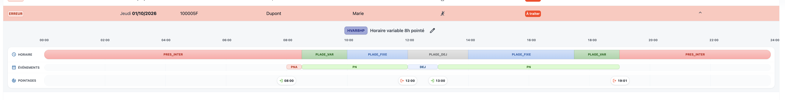

# Présence non autorisée non générée

Dans le cas ci-dessous, un event de présence injustifiée devrait être généré de 19:00 à 19:01 (1 minute) or ce n’est pas le cas:

Cf. 

Si on modifie le pointage de 19:01 et qu’on met 19:02, cela fonctionne: il y a donc un problème de précision à la minute prêt à corriger.

@Pierre-Olivier Courtois > Max: De mémoire c'était une demande explicite de ne pas générer d'évents de moins d’une minute ?

@Maxime Chevasson > Ce n’est pas un event de moins d’1 minute mais un event d’une minute. Il est impératif d'être précis à la minute prêt et là c’est à 2 minutes prêt donc KO. Je rappelle également que les secondes doivent être ignorées dans les calculs (tronquées)
