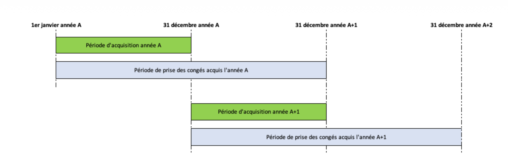

# ⚖️➡️ Abs. droits / Reprise

Je propose de réattaquer les absences avec droits pour les 3 jours restants.

Cf. audit de ce qui est déjà fait, ce qui reste à faire, les différences [ici](./261021-audit-avancement/audit.md)

---

## Resources

Ci-joint les mockups produits par Claude qui, modulo certaines hallucinations et infos manquantes, tiennent globalement la route: [ici](./mockups/)

La première page est à destination des salariés : [Mes droits et soldes](./mockups/1-collaborateur---mes-droits-et-soldes.png)

La 2eme et la 3eme est à destination des gestionnaires RH :

- [Consultation individuelle](./mockups/2-gestionnaire-rh---consultation-individuelle.png)
- [Consultation collective](./mockups/3-gestionnaire-rh---consultation-collective.png)

Les autres (hors page 7 qui illustre les effets d'une pose) sont celles à mettre à disposition d'un administrateur

On va démarrer en s'attaquant à la gestion des congés payés d'Arte qui ne sont pas trop compliqués en dehors de certains cas spécifiques mais on va se concentrer dans un premier temps sur le cas général et on verra ensuite pour les subtilités.

---

## Description du besoin Arte

La période de référence pour l'acquisition des congés payés est l'année civile (1er janvier au 31 décembre).

Les salariés d'ARTE France ont droit à un congé annuel de :

- 2,5 jours (deux jours et demi) ouvrés par mois dans la limite de 30 (trente) jours ouvrés pour les salariés
ayant moins d'un an de présence dans l'entreprise pendant la période de référence.
- Pour les salariés titulaires d'un contrat de travail de moins d'un mois, les 2,5 jours (deux jours et demi) de congés seront calculés au prorata de la durée dudit contrat selon la formule suivante :
- 2,5 / Nombre de jours ouvrés du mois x Nombre de jours travaillés du mois ;
  - 30 (trente) jours ouvrés pour les salariés ayant un an de présence dans l'entreprise pendant la période de référence, soit 6 (six) semaines de congés payés.
- Les stagiaires ne bénéficient pas de congés payés.
- Les congés payés sont acquis mois après mois et peuvent être pris dès l'ouverture des droits à congé :
  - ainsi le salarié qui a travaillé un mois dans l'entreprise est en droit de prendre dès le mois qui suit, les jours de congés qu'il a acquis.
- Les droits à congé annuels acquis sont appréciés au 1er janvier de chaque année, la période de référence s'étalant du 1er janvier au 31 décembre de l'année N-1.
- Une fois acquis, les droits peuvent être pris jusqu'au 31 décembre de l'année suivant la période d'acquisition.
- Les principes d'acquisition et de prise sont schématisés ci-dessous

Les salariés à temps partiel ou en forfait réduit ont droit au même nombre de jours de congés payés que les salariés à temps plein. Leurs jours de congés seront décomptés de la manière suivante :

- du premier jour ouvré où le salarié aurait dû travailler s'il n'était pas parti en congé ;
- jusqu'à la veille du jour ouvré de la reprise du travail.

Le fractionnement du congé annuel (congés pris en dehors de la période du 1er mai au 31 octobre) ne donne pas droit à des jours de congés supplémentaires. A titre de compensation, les salariés bénéficient déjà de 5 (cinq) jours ouvrés de congés supplémentaires, inclus dans les trente jours ouvrés de congés payés annuels.

Les demandes de congés payés sont soumises par les collaborateurs via le self-service par le biais d'un workflow de validation avec validation du manager.

La Solution permettra de calculer et de suivre les volumes de congés payés en cours d'acquisition, acquis sur la période de référence et le volume de congés payés reportés.

La régularisation des droits annuels se fait sur le bulletin du mois de janvier de l'année suivante (les congés en cours de l'année N-1 deviennent des congés acquis au 1er janvier de l'année N).

### Report des congés payés

Le report des congés payés est effectué de manière exceptionnelle sur demande du salarié (cas de longue absence, charge de travail importante, etc.) après validation du manager puis de la RH.

Le report des congés sont autorisés en cas,

- D'absence liée à un congé maternité ;
- D'arrêt maladie tel que visé à l'article 3.15.2 sous certaines conditions.

La Solution doit permettre la mise à jour simple des compteurs en début de période par saisie des gestionnaire RH pour les congés annuels et par report automatique pour les motifs légalement admis au report.

### PO > Mes questions

#### Question 1

Histoire de se remettre dans le bain en ayant les idées au clair, peux tu parcourir le doc word en pièce jointe et indiqué dans la colonne “Géré” ce qui est déjà codé et ce qui ne l'est pas (ou partiellement) ?

Note max: [Complété ici](./261021-audit-avancement/audit.md).

#### Question 2

Concernant le calcul des droits, qu'est ce que qui déclenche le calcul exactement et quand a t-il lieu ? Ce n'est clairement pas quelque chose que l'on peut faire dans le futur puisque les droits acquis sont susceptibles d'être impactés par ce qui s'est passé sur la période écoulée (exemple: mon droits mensuel est habituellement de 2,5 jours par mois mais j'ai été malade tout le mois donc mon droit va être diminué du fait de la maladie)

Réponse max :

##### Récap

La génération ne crée que les mouvements d'acquisition « en cours » (addInProgress), et seulement pour un droit géré par exercice dont la valeur d'acquisition est une constante, pour les ressources des populations cibles. Chaque date reçoit cette valeur telle quelle (montant par période, 2,5 ou 3 dans les seeds).

Les droits non gérés par exercice et l'évaluation des compteurs sont encore des TODO : rien n'est produit. Les soldes ne sont pas recalculés. Les 18 natures de mouvement existent dans le référentiel. L'exemple 1 (années n-1, n, n+1) est chargé en données statiques, il n'est pas produit par le moteur.

##### Écarts avec le récap d'octobre 2026

La vérification d'appartenance à la population cible à la date de prise n'a pas de champ.

La règle « une seule ligne par date d'effet et code droit » est incompatible avec plusieurs natures le même jour, y compris dans les seeds d'exemple.

Le mouvement n'a ni date d'expiration, ni date de fin de validité, ni lien vers l'instance d'event.

Les montants perdus ou payés, et les pris sur en cours, acquis et report, ne sont pas des colonnes séparées.

PG-22 et PG-23 n'ont pas de paramètre. Le compteur de contrôle des prises est le seul emplacement possible, et il n'est pas évalué.

RelativePeriod n'est pas utilisé par les absences en droit. Les délais passent par Period. Les RelativeDate sont stockées et ne sont pas résolues à la génération.

Quatre natures « bascule automatique » existent en plus des 14 du récap. Elles ne sont pas produites.

Le plafond de transfert est en base. Il n'apparaît pas dans le tableau 3.4 du récap.
