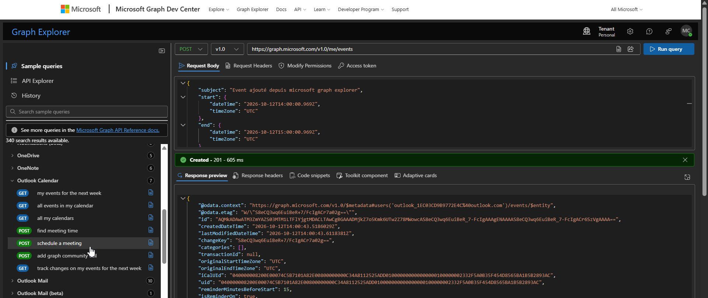
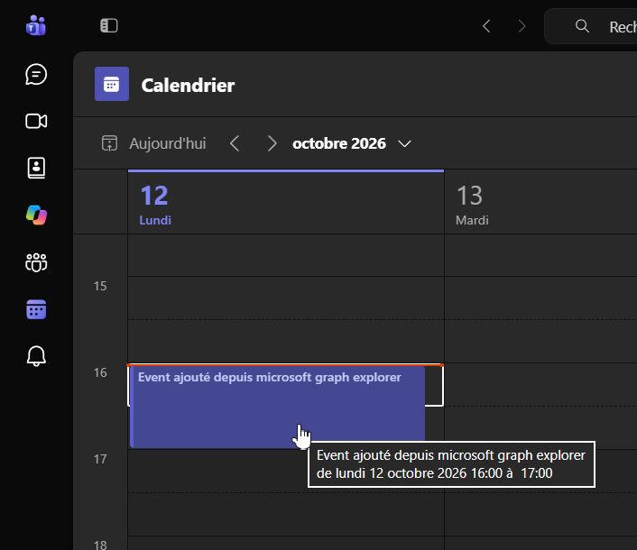

# GTA-1849 / Interface des events avec les calendriers outlook

(in french)

## Métier

Expression de besoin :

ARTE France utilise Microsoft Outlook pour la gestion de la messagerie et des calendriers de ses collaborateurs.

Afin que les calendriers reflètent la disponibilité réelle des collaborateurs, la Solution devra permettre la synchronisation automatique des événements de GTA vers les calendriers Microsoft Outlook des personnes concernées, sans intervention de l'utilisateur (notamment sans acceptation d'une invitation ou exécution d'une action manuelle).

Note dev : 🔐 je suis sûr à 95% qu'il faudra à minima une première action de confirmation au niveau des droits d'Outlook

Cette fonctionnalité est particulièrement attendue par les collaborateurs et constituera un élément fortement différenciant dans l'évaluation des offres.

La Solution devra notamment permettre :

- La création, la mise à jour et la suppression automatiques des événements de GTA dans les calendriers Outlook ;
- La synchronisation des événements validés ainsi que, si la Solution le permet, des événements en attente de validation avec un statut permettant de les identifier comme provisoires ;
- La définition du libellé transmis à Outlook pour chaque type d'événement (télétravail, absence, astreinte et autres événements gérés par la GTA).

La synchronisation devra être exécutée automatiquement au minimum une fois par jour.

Note dev : Hors scope pour moi tant qu'on à pas touché aux CRONs..

Le candidat décrira précisément :

- les modalités d'interopérabilité de sa Solution avec Microsoft 365 / Exchange Online
- les technologies utilisées (notamment Microsoft Graph)
  - 🔍 [Microsoft Graph](https://learn.microsoft.com/fr-fr/graph/overview)
- les prérequis techniques
- ainsi que les droits nécessaires à la mise en œuvre de cette synchronisation.

Exemple de spécifications issues d'un autre client qui décrit le mode de fonctionnement attendu : cf. [Interface Outlook - Catpures.pdf](./Interface%20Outlook%20-%20Captures.pdf)

---

## Dev

Recherches et tests préliminaires : 🔍 [Microsoft Graph](https://learn.microsoft.com/fr-fr/graph/overview)

- Dans la plateforme Microsoft 365, trois composants principaux permettent l'accès aux données et le flux :
  - API Microsoft Graph > API REST ou des kits de développement logiciel (SDK)
  - Microsoft 365 Copilot connecteurs // a priori hors scope
  - Connexion aux données Microsoft Graph // pas compris la diff avec API
- Microsoft Graph propose des API REST et des bibliothèques clientes pour Services principaux Microsoft 365 Outlook/Exchange People (contacts Outlook), Planificateur, etc.
  - [Vidéo d'intro](https://www.youtube.com/watch?v=PI9NO5rayiY) ~4mn
- [site officiel ms graph](https://developer.microsoft.com/en-us/graph)
- Graph explorer // testé en live
  - 🔐 Demande bien l'accès aux infos perso du compte microsoft lors du login !
  - ✅📌 my profile
  - ✅📌 outlook calendar > all events
    - 🔐 "Access is denied. Check credentials and try again."
    - ✅🔐Maj des droits
    - ✅ Ca récupère bien les derniers meetings
  - ✅📌 outlook calendar > essai de POST > schedule a meeting

Résultats des tests en image :

1. 
2. 

ATTENTION ! La je suis sur leur site bien balisé et tout mais d'expérience, la mise en place de credentials (authentification) dans des sites tiers c'est souvent une purge, quand ça n'est pas purement et simplement pas accessible en local.

En dehors de ça l'API est très bien faite, simple et abordable, on pourra s'interfacer sans soucis dessus

Faire attention pour les synchronisations à voir (différencier events de Cronexia des Events persos des collaborateurs)

Note @PO : Clairement cela veut dire que cela peut marcher dans les deux sens, on pourrait également rapatrier les events des calendriers Teams dans la solution cronexia ; idem pour les infos de contacts, etc. (en gros tu te logues avec Teams > ça te pré-rempli ton nouveau profil collaborateur cronexia) ou ce genre de choses

---

## Questions/réponses

@PO: 1849: Ok. Pour ce ticket j'aurais besoin d'un descriptif sommaire du fonctionnement envisagé pour le mettre dans la réponse (pas la peine de rentrer dans les détails trop poussés mais répondre aux points demandés dans le ticket) quitte à dire qu'on affinera lors de la phase d'analyse. En tout cas, ils y tiennent à cette interface donc plus on leur donne le sentiment qu'on sait faire.

Max: Fonctionnement envisagé :

- Création de 3 routes API Cronexia, permettant
  - l'inscription au service de synchronisation du calendrier outlook
  - la synchronisation (création, modification, ou suppression), similaire à la commande rsync
  - la des-inscription au service
- Pour chaque Profil d'utilisateur inscris, son calendrier associé (via les credentials Microsoft) sera mis à jour toutes les XX heures via un CRON

PO: Ce qui dit a mis ne suffit pas (note dev: il s'agit de ce ticket Jira qui comporte les tests & retours d'exemples en images) car c'est ok pour nous en interne mais j'ai besoin d'un truc rédigé que je puisse copier/coller dans l'AO Arte: reprendre l'expression de besoin du ticket et rédiger un truc clean et pas excessivement technique qui explique le fonctionnement envisagé sans rentrer dans les détails.
