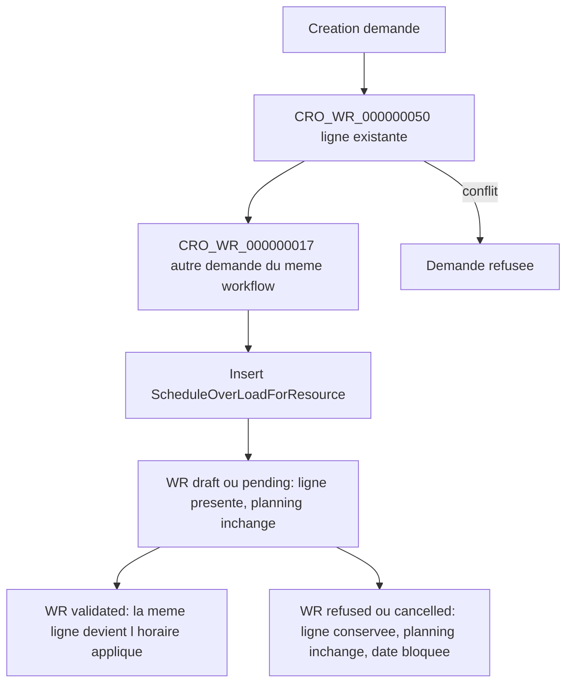

# GTA-1894 — revoir le fonctionnement des surcharges d'horaire

Le retour PO : il doit être possible de demander un changement d'horaire même si une surcharge existe déjà. Acceptée, la demande remplace la surcharge en place au planning. Refusée, la surcharge en place reste.

Ce document sert à découper des sous-plans d'implémentation. Pas de code dans ce passage.

## Deux origines

Une surcharge d'horaire arrive par l'un de ces deux chemins. Les deux écrivent `ScheduleOverLoadForResource`.

- Demande. La ressource crée une demande `pending` ; chaque jour demandé a déjà sa propre ligne `ScheduleOverLoadForResource` liée à ce `WorkflowResource`. Un valideur (exemple Manager) accepte ou refuse. La ligne n'est appliquée au planning que si la demande est `validated`. Un refus ne change pas l'horaire déjà en vigueur.
- Imposée hors workflow. Un profil plus élevé (HrManager) ou un admin pose la surcharge directement, sans `WorkflowResource`. Règle : une surcharge sans workflow associé est considérée validée. Elle s'applique tout de suite.

Le filtre planning actuel : ligne candidate si `workflowResourceId` est null, ou si la demande liée est `validated` ([get-overloaded-schedules-for-resources-and-period.ts](../../../cronexia-gta-back/app/src/resources/functions/service/get-overloaded-schedules-for-resources-and-period.ts)). Une demande `draft`, `pending`, `refused` ou `cancelled` n'est pas une surcharge en vigueur. Les sous-plans conservent ce critère, avec une règle de départage quand plusieurs candidates existent (voir direction).

Une surcharge sans workflow n'a pas de badge de statut. `resolveWorkflowStatusBadge` reste vide tant qu'aucune demande n'est liée. Le badge ne concerne que le chemin demande.

## Constat

Aujourd'hui une ressource n'a qu'une `ScheduleOverLoadForResource` par jour : [schedule-over-load-for-resource.prisma](../../../cronexia-gta-back/app/prisma/schema/schedule-over-load-for-resource.prisma) porte `@@unique([resourceId, effectDate])`. C'est ce qui bloque le PO.

La demande et sa surcharge sont déjà la même ligne, créée à la création du WR (brouillon inclus) via `scheduleOverLoads.create`. Valider ne copie rien : le passage à `validated` rend cette ligne visible au planning. Refuser ne la supprime pas. Une demande refusée, annulée, brouillon ou en attente occupe la clé unique sans être l'horaire affiché. D'où [GTA-1894-01](GTA-1894-01-ce-qui-a-ete-fait-pour-le-ticket-originel.md) et `CRO_WR_000000050`.

Deux gardes à la création et à la mise à jour ([workflow-resources.resolver.ts](../../../cronexia-gta-back/app/src/workflow-resources/workflow-resources.resolver.ts)) :

- `CRO_WR_000000050` — n'importe quelle ligne sur la ressource et la date. Blocage que le PO refuse.
- `CRO_WR_000000017` — autre demande du même workflow sur ces dates, hors `draft` / `refused` / `cancelled`. Une demande déjà `validated` bloque encore. Le pointage exclut `validated` (`CRO_WR_000000038`) : une demande validée ne bloque pas, la plus récente remplace la journée.

La pose hors workflow ([schedule-over-load-for-resources.service.ts](../../../cronexia-gta-back/app/src/schedule-over-load-for-resources/schedule-over-load-for-resources.service.ts) `create`) sur P2002 supprime la ligne et la recrée. Ce chemin réécrit l'historique s'il existe déjà une ligne liée à une demande. À changer avec la direction ci-dessous.

## Direction retenue pour les sous-plans

Chaque demande possède ses propres lignes `ScheduleOverLoadForResource`, créées avec elle, et les conserve. On n'en réécrit jamais une pour en servir une autre. Deux demandes sur la même date (créées à des jours différents, validées ou refusées par des managers différents) = deux jeux de lignes. Réutiliser une seule ligne ouvrirait à réécrire l'historique (horaire, rattachement, validateurs).

Pas de nouvelle collection « jours demandés ». On garde le modèle actuel : le sujet de la demande `scheduleOverload` reste `scheduleOverLoads` sur le WR.

Ce qui change :

- Lever `@@unique([resourceId, effectDate])`. Plusieurs lignes peuvent coexister pour la même ressource et la même date (pending à côté d'une validée, annulée à côté d'une nouvelle, etc.). Unicité utile côté demande : une date une seule fois par WR (`(workflowResourceId, effectDate)` quand `workflowResourceId` est non null). Les poses hors workflow (`workflowResourceId` null) : au plus une ligne « admin » active par date, ou règle de départage à caler dans le sous-plan schéma / pose hors workflow.
- Création et mise à jour de demande : toujours `scheduleOverLoads.create` lié à ce WR. Plus de blocage 050 parce qu'une autre ligne existe déjà.
- Acceptation : aucun update de la ligne d'une autre demande. Les lignes de la demande qui passe `validated` deviennent candidates au planning via le filtre d'état. Remplacement fonctionnel = le planning lit désormais cette demande plutôt que l'ancienne.
- Refus : aucune écriture sur les lignes des autres demandes. Les siennes restent liées, hors planning.
- Planning / compteurs : candidats = `workflowResourceId` null (considéré validé) ou WR `validated`. S'il y en a plusieurs pour la même date, départager (alignement proposé sur le pointage : la plus récente l'emporte, ex. `submissionDate` / date de validation). Une seule surcharge est alors effectivement affichée, sans muter les autres lignes.
- Pose HrManager / admin : ne plus `delete` + `create` sur P2002 si la ligne existante appartient à une demande. Insérer (ou mettre à jour uniquement) une ligne sans workflow, sans toucher aux lignes historiques des WR. Le départage planning décide ensuite laquelle s'affiche.

À écarter : mettre à jour `scheduleId` / `workflowResourceId` d'une ligne déjà liée à une autre demande pour « remplacer » l'horaire.

## Annulation : les deux enregistrements restent

Une demande dont l'annulation a été acceptée n'est pas supprimée. Elle reste en historique avec les deux statuts en même temps :

- `WorkflowResource.state` = `WorkflowStateEnum.cancelled`
- `WorkflowResource.stateDebug` = `WorkflowDebugStateEnum.cancellationValidated`

C'est le parent, pas la demande d'annulation. Le seed Patrick le montre déjà : scénario 25, `state: cancelled` et `stateDebug: cancellationValidated`, surcharge toujours posée par `attach` sur le 24/07/2024 ([workflow-resource-02-patrick-so-2-validations.seed.ts](../../../cronexia-gta-back/app/prisma/seeds-new/50-dev/workflow-resource/schedule-overload/workflow-resource-02-patrick-so-2-validations.seed.ts)). La demande d'annulation (scénario 26) est l'enfant : `state: validated`, `stateDebug: cancellationValidated`, `isCurrentDemandCancel: true`.

La `ScheduleOverLoadForResource` de la demande annulée n'est pas supprimée non plus. Demande + lignes liées = historique. Pas de `delete`, pas de détachement, pas de réutilisation pour une demande suivante. `cancelled` sort du filtre planning. Une nouvelle demande crée ses propres lignes.

Le chemin actuel qui supprime un brouillon, ou une demande encore entièrement `pending`, reste à part ([resources-cancel-workflow-resource.ts](../../../cronexia-gta-back/app/src/resources/functions/workflow-resource/resources-cancel-workflow-resource.ts), `deleteWorkflowResourceAndLevelStates` / [delete-workflow-resource-cascade.ts](../../../cronexia-gta-back/app/src/resources/functions/workflow-resource/delete-workflow-resource-cascade.ts)). Chaque SO est déjà liée à son WR : la suppression cible `workflowResourceId` (id de la demande), pas un composite `(resourceId, effectDate)`. Après levée de l'unicité globale, ce ciblage par id reste le bon modèle et évite d'effacer une autre demande sur la même date.

## Règles de garde à changer

- Retirer `CRO_WR_000000050` comme blocage « une surcharge existe ». Dictionnaire et spec du garde suivent.
- Pour `scheduleOverload`, aligner le doublon sur le pointage : une demande `validated` ne bloque pas une nouvelle demande. Une demande en cours (`pending`, `awaitingAttachements`) sur les mêmes dates bloque toujours. Les brouillons sont déjà exclus du garde 017 ; décider dans le sous-plan gardes si deux brouillons sur la même date restent interdits (recommandé : oui, une seule demande ouverte par date).
- Chevauchement partiel : par jour. Mardi déjà surchargé ailleurs dans une demande lun–mer : à l'acceptation, mardi devient candidat via les lignes de cette demande ; au refus, l'horaire en vigueur précédent reste celui du planning.
- Annulation acceptée : `cancelled` + `cancellationValidated`, surcharge conservée. Le garde 017 exclut déjà `cancelled`. La nouvelle demande crée ses propres lignes.

## Affichage

Aujourd'hui [WorkflowScheduleChangeDaysPanel.svelte](../../../cronexia-gta-front-v2/app/src/routes/components/cronexia/workflow/demand-details/WorkflowScheduleChangeDaysPanel.svelte) a deux lignes, alimentées par [schedule-change-workflow-display.helpers.ts](../../../cronexia-gta-front-v2/app/src/routes/functions/cronexia/workflow/schedule-change-workflow-display.helpers.ts) :

- « Horaire prévu » = cycle, `originalScheduleCode` (sans appliquer les surcharges, [build-original-schedules-by-date-for-resource.ts](../../../cronexia-gta-back/app/src/resources/functions/workflow-resource/build-original-schedules-by-date-for-resource.ts)).
- « Horaire demandé » = `schedule` des lignes de la demande consultée.

Il manque l'horaire surchargé déjà en vigueur (autre demande `validated`, ou pose hors workflow). Le bloc GraphQL `typedScheduleOverload` ([map-prisma-to-workflow-resource-typed-schedule-overload.ts](../../../cronexia-gta-back/app/src/resources/functions/workflow-resource/map-prisma-to-workflow-resource-typed-schedule-overload.ts), [schedule-over-load-for-resource-embedded.model.ts](../../../cronexia-gta-back/app/src/schedule-over-load-for-resources/models/schedule-over-load-for-resource-embedded.model.ts)) doit exposer, par jour, en plus du cycle et du demandé :

- horaire en vigueur, optionnel : la ligne effectivement retenue par le départage planning pour cette date (pas la ligne de la demande consultée si elle n'est pas encore / plus celle en vigueur).

Le panneau (grille et liste étroite) ajoute une ligne entre le cycle et le demandé, rendue seulement si cet horaire existe. Libellé proposé : « Horaire en vigueur ». Même panneau collaborateur / valideur via [WorkflowDemandDetailsCard.svelte](../../../cronexia-gta-front-v2/app/src/routes/components/cronexia/workflow/demand-details/WorkflowDemandDetailsCard.svelte) : [demands](../../../cronexia-gta-front-v2/app/src/routes/%28app%29/%28without-filters%29/demands) et [request-management](../../../cronexia-gta-front-v2/app/src/routes/%28app%29/%28with-filters%29/request-management).

Demandes annulées : elles conservent leur propre WR et leurs SO. Affichage comme les autres états, avec le statut `cancelled` (couleur rouge normalisée déjà utilisée pour ce statut). Si le cas devient dense (horaire d'origine + SO annulée + nouvelle SO), une bordure rouge ou un marqueur léger peut aider. Ne pas détailler le UI maintenant : au moment du sous-plan affichage, poser la question avant de figer le rendu.

Badge : ne pas en créer un nouveau.

- La carte de demande a déjà `BadgeWorkflowState`.
- Le planning collectif peint déjà une bordure ou une icône d'horaire via `resolveWorkflowStatusBadge` dans [CollectiveScheduleGrid.svelte](../../../cronexia-gta-front-v2/app/src/routes/components/cronexia/collective-schedule/CollectiveScheduleGrid.svelte), à partir de `workflowStatus`. Rattachement demande / jour : [planning-workflow-resolve.helpers.ts](../../../cronexia-gta-front-v2/app/src/routes/functions/cronexia/planning/planning-workflow-resolve.helpers.ts) (`resolvePlanningWorkflowForSchedule`).
- Sous-plan front séparé : vérifier qu'une demande d'horaire non validée alimente bien ce `workflowStatus` sur la pastille, sans remplacer l'horaire en vigueur avant acceptation.

---

Attention, pour l'implémentation ou la mise a jour des tests unitaires dans le front, respecter les conventions : cronexia-gta-front-v2\instructions-tests-unitaires.md

---

## Découpage en sous-plans

Note : quand un sous plan est terminé, le suffixer avec " / ✅ Terminé / "

---

Chaque bloc ci-dessous est un futur fichier de sous-plan. L'ordre est celui des dépendances.

1. / ✅ Terminé / Schéma et migration. Lever `@@unique([resourceId, effectDate])`. Ajouter une contrainte adaptée pour éviter deux fois la même date sur un même WR (`(workflowResourceId, effectDate)` quand lié). Pas de nouvelle table « jours demandés ». Backfill : aucune conversion de sujet ; les lignes existantes restent. Pose hors workflow : ne plus supprimer une ligne liée à un WR sur conflit. Cascade brouillon / pending : continuer à supprimer les SO via `workflowResourceId` de la demande cible uniquement ([delete-workflow-resource-cascade.ts](../../../cronexia-gta-back/app/src/resources/functions/workflow-resource/delete-workflow-resource-cascade.ts)) — plus simple et sûr une fois l'unicité globale levée. Ne pas prendre ce chemin comme modèle pour l'annulation acceptée.

2. / ✅ Terminé / Écriture de la demande. [workflow-resources.resolver.ts]. (../../../cronexia-gta-back/app/src/workflow-resources/workflow-resources.resolver.ts) création et mise à jour : continuer `scheduleOverLoads` liés à ce WR. Plus d'échec parce qu'une autre ligne existe sur la date. Front create helpers / routes API : inchangés dans l'esprit, hors message d'erreur 050. Doc [create.doc.ts](../../../cronexia-gta-back/app/src/workflow-resources/docs/create.doc.ts) : retirer la phrase sur `CRO_WR_000000050`.

3. / ✅ Terminé / Gardes. Suppression du blocage 050. Doublon 017 : une demande validée ne bloque plus ; une demande en cours sur la même date bloque. Specs : [guard-existing-schedule-overload-for-resource.spec.ts](../../../cronexia-gta-back/app/src/workflow-resources/functions/guard-existing-schedule-overload-for-resource.spec.ts) et le spec du garde doublon. Tests à la main.

4. Planning / application. Pas d'écriture de remplacement sur validation : les lignes de la demande sont déjà là. Adapter le départage dans [get-overloaded-schedules-for-resources-and-period.ts](../../../cronexia-gta-back/app/src/resources/functions/service/get-overloaded-schedules-for-resources-and-period.ts) (et tout map qui suppose une seule ligne par date) pour retenir une seule candidate effective. Refus : noop sur les autres lignes. Annulation acceptée : écrire `cancelled` + `cancellationValidated`, laisser demande + SO. Pose admin / HrManager : insert sans écraser l'historique des WR. `TheoreticalClockingOverload` reste enfant de chaque SO ; pas de transfert entre demandes.

5. Lecture GraphQL. Ajouter l'horaire en vigueur (après départage) à côté de `originalSchedule*` dans le modèle embarqué et le mapper. Queries resource et UPI. Docs : [resources-get-workflow-resource.doc.ts](../../../cronexia-gta-back/app/src/resources/docs/resources-get-workflow-resource.doc.ts) et [user-profile-instance-get-workflow-resource.doc.ts](../../../cronexia-gta-back/app/src/user-profile-instances/docs/user-profile-instance-get-workflow-resource.doc.ts). Puis types front.

6. Panneau des jours. Types [workflow-demand-details.types.ts](../../../cronexia-gta-front-v2/app/src/routes/functions/cronexia/workflow/workflow-demand-details.types.ts), helpers d'affichage, maps employé / valideur, [build-workflow-demand-details.ts](../../../cronexia-gta-front-v2/app/src/routes/functions/cronexia/workflow/build-workflow-demand-details.ts). Troisième ligne optionnelle « Horaire en vigueur ». Demandes `cancelled` : même structure, badge / statut cancelled (rouge normalisé). Cas dense (origine + annulée + nouvelle) : demander avant de figer (bordure rouge ou autre). Autres lecteurs de `typedScheduleOverload.scheduleOverLoads` (widgets, calendrier, planning-resolve, planning-data-to-events) : continuer à lire les lignes de la demande consultée, pas confondre avec l'horaire en vigueur global.

7. Badge planning. Vérifier le `workflowStatus` sur la pastille d'horaire pour une demande non validée, sans changer l'horaire affiché tant qu'elle n'est pas acceptée.

8. Seeds. Jeu dev Patrick SO + helper d'insert. Jeu démo (Luc, Marc, Maxime, Paul, Pierre). Chaque scénario garde ses propres SO liées au WR. Ajouter : demande pending sur date déjà portée par une demande `validated` ; demande pending sur date portée par une surcharge sans workflow. Scénarios annulation 25/26 : parent `cancelled` + `cancellationValidated` avec SO toujours présentes.

## Cas manuels une fois les sous-plans faits

- Date sans surcharge : demande, refus, planning au cycle. Deuxième demande, acceptation, planning sur la nouvelle. Les deux WR gardent leurs lignes.
- Date avec surcharge sans workflow ou demande déjà validée : nouvelle demande part (lignes à elle). Planning inchangé tant qu'elle est pending. Refus : ancienne en vigueur. Acceptation : planning bascule sur la nouvelle ; l'ancienne ligne reste en base, liée à l'ancien WR.
- Pose HrManager / admin : nouvelle ligne sans workflow, sans delete des SO de demandes. Départage planning. Une demande pending ouverte n'est pas modifiée.
- Annulation acceptée : parent `cancelled` + `cancellationValidated`, SO conservées, hors planning. Nouvelle demande possible avec ses propres lignes.
- Deux demandes en cours sur la même date : la seconde est refusée par le garde de doublon.
- Outrepassement RH et validation au dernier niveau : même bascule planning, sans muter les autres SO.
- Détail collaborateur / valideur : cycle, horaire en vigueur si présent, horaire demandé. Annulée : statut cancelled (rouge). UI dense : à trancher au sous-plan affichage.
