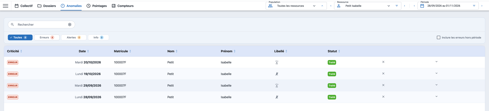
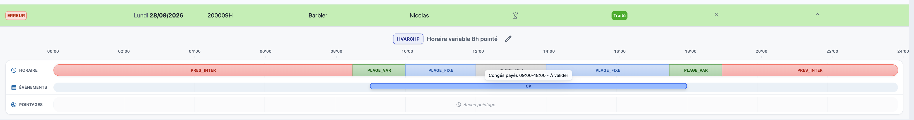

# Retours

## PO, commentaire Jira

Ce que je constate au niveau de la génération des anomalies et qui n’est pas correct:

j’affiche la page de gestion des anos pour Isabelle Petit du 28/09 au 01/11. Le tableau des anomalies est vide car elles n’ont pas été lancées (OK normal). Je lance le traitement de génération des anos et les lignes ci-dessous s’affichent:

C’est totalement faux: Isabelle Petit est géré par pointages théoriques donc en l’absence de PDEC et d’ADEC, elle aurait été considérée comme ayant travaillé sur les plages définies dans ces pointages théoriques. Les events PDEC et ADEC ne viennent en aucun cas corrigé des anomalies de présence ou d’absence. Ils viennent seulement indiquer des écarts par rapport à ses pointages théoriques. Le comportement attendu après exécution du traitement des anomalies est donc d’obtenir un tableau complètement vide: aucune anomalie à signaler.

Je génère les anomalies pour Nicolas Barbier le 28/09. Il est géré en pointages réels et il a un CP à l'état “A valider” sur cette journée: ce CP est pris en compte dans la génération des anomalies et il est donc, à tort, considéré comme “Traité” du fait de la présence de ce CP non encore validé:

Le descriptif du ticket indiquait:  Traiter les états “En attente” / “A valider” comme ceci:

Pas d’impact sur la génération des anomalies (ces events doivent être ignorés) KO actuellement ⏱️ 0,1j

Ne repasser ce ticket en recettage qu’une fois l’ensemble des points traités

## Retours Ferhat sur MS Teams

## Ferhat

J'ai regardé le commentaire de PO sur GTA-1911.

1) CP « À valider » pris en compte dans les anos
C'est de mon côté : ma PR GTA-1789 #99 faisait compter les demandes en attente dans le générateur. C'est corrigé, PR à venir : le générateur revient sur ton filtre (validées seulement), et la popup front continue de compter « en attente ».

2) Isabelle Petit (pointages théoriques) : il faut qu'on se mette d'accord
- Ce qui se passe : le générateur part de sa présence théorique, puis traite l'ADEC comme une absence et le PDEC comme une présence. Il crée donc une ABSINJ (ADEC) ou une PNA (PDEC hors horaire), aussitôt « résolue » par l'ADEC / le PDEC. Avec ta reprise de la génération, ces anos résolues sont gardées au statut « Traité », d'où les lignes que PO voit.
- Ce que PO attend : ADEC et PDEC ne corrigent pas une ano. Ce sont des écarts par rapport aux pointages théoriques, donc le tableau doit rester vide.
- Deux pistes :
  a) pour une ressource en pointages théoriques, appliquer les ADEC / PDEC à la présence de référence (retirer le créneau ADEC, ajouter le créneau PDEC) avant la détection, pour qu'aucune ano ne soit créée ;
  b) plus simple : ne pas garder les anos « Traité » quand elles sont résolues par un ADEC / PDEC.
  La a) colle mieux à ce que dit PO, mais elle touche le cœur de la génération que tu viens de reprendre.

Tu préfères le prendre dans GTA-1911, puisque c'est ta génération, ou je m'en occupe dans GTA-1789 ? Et quelle piste te paraît la bonne ?

le deuxième point a voir avec toi je peux pas décider seul

comme ca sort de fou de mon scope du ticket, je fais que exploser mon ticket lol

je pense il faut le revoir avec po non ?

## Max (moi)

Hm en l'état je l'aurais plutôt récupéré, mais si tu es dessus et qu'on risque des conflits j'aurais tendance a te le laisser

Ca dépend de ton état d'avancement dans les tickets, de mon côté j'ai de l'avance je peux le récupérer après mon taf sur les compteurs sinon

## Ferhat

Moi j'ai corrigé le premier point, je vais répondre sur ton commentaire, mais le deuxième, je suis pas vraiment dedans. Là ça touche à la logique qui résout les conflits, c'est tout autre chose qu'exclure des états de la génération.

je prefere ne pas le récuperer sinon je vais etre dans le jus

## Max

Oki je le récupère alors
