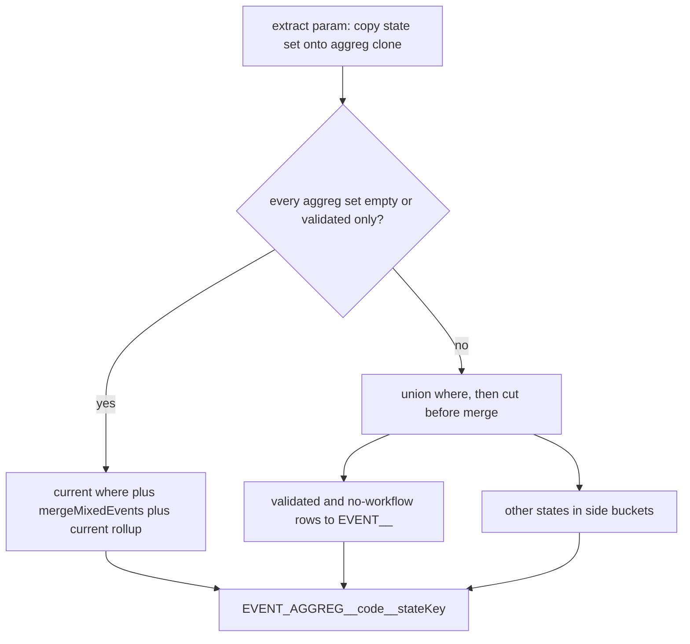

# GTA-1915 / États des events sur les agrégats des compteurs

Découpe de [01---GTA-1915-compteurs-gestion-etat-des-events-pour-aggregats-uniquement.md](01---GTA-1915-compteurs-gestion-etat-des-events-pour-aggregats-uniquement.md), scope du 09/11 : les agrégats seulement.

Une formule peut citer deux fois la même agrégation, avec deux jeux d'états. L'exemple PO :

> Var presence = EventsAggregation "Groupe TT Etat Validé" + EventsAggregation "Groupe TT Etat A valider"

Ce n'est pas une nouvelle agrégation en base. C'est le même `EventsAggregation.code`, et les états sont portés par le paramètre du compteur. Sans état, le paramètre ne compte que Validé.

Ce fichier pose la règle. [03---GTA-1915---implement-events-states-for-counters-events.md](03---GTA-1915---implement-events-states-for-counters-events.md) la reprend pour un event seul. [04---GTA-1915---adjust-existing-counters.md](04---GTA-1915---adjust-existing-counters.md) réécrit CPPA / RTTPA / TTPA et retire `VALEUR_EVENT_ETAT` / `SOMME_ANNEE_ETAT`.

Hors de ce fichier : paramètre `Event`, formules de congés, somme de quantités, contrôle de droits, affichage planning.

Estimation proposée : ⏱️ ~2 j. À confirmer après la question PO en fin de fichier. La découpe Prisma est mécanique et compte dans ce délai.

---

## Règle cible

`WorkflowStateEnum` dans `cronexia-gta-back\app\prisma\schema\workflow.prisma`.

Le jeu d'états vit sur le `CtParam` (`entityType: EventsAggregation`), pas sur `EventsAggregation`. Plusieurs états sur un paramètre = OU. Une liste écrite remplace le défaut, elle ne s'y ajoute pas.

| Jeu d'états sur le paramètre | Events comptés dans l'agrégat |
| --- | --- |
| Aucun (défaut) | Validé seul |
| `validated` — Validé, seul | Validé seul |
| `pending` — A valider, seul | A valider seul |
| `validated` + `pending` | Validé ou A valider |
| `awaitingAttachements` — En attente de justificatif | Cet état seul, seulement s'il est dans la liste |
| `draft` — Brouillon | Seulement s'il est dans la liste |
| `refused` — Refusé | Seulement s'il est dans la liste |
| `cancelled` — Annulé | Seulement s'il est dans la liste |

Validé = demande `validated`, ou saisie directe sans workflow. GTA-1911 compte déjà la saisie directe comme Validé. Le défaut et la ligne `validated` seule ont le même effet.

Jours (`EventRangeOnResource`) : sans `workflowResourceId`, ou `workflowResource.state` dans le jeu. Heures (`EventByDay`) : l'état est sur la déclaration (`EventByDay → DeclarationHourly → Declaration → WorkflowResource`), comme GTA-1911. Une saisie en heures sans déclaration, ou une déclaration sans workflow, compte avec Validé. Un écart ADEC / PDEC compte quand la déclaration est dans le jeu.

`PVA` ne déclare pas d'état. Son résultat ne change pas : `GROUPE_TT` reste Validé seul.

---

## État des lieux

Les formules ne sont pas un texte parsé. Un paramètre est une ligne `CtParam`. L'affichage, dans `functions/display/counter/param.ts`, est `EventsAggregation "GROUPE_TT" (label) <duration><Float>`. Le commentaire du seed PVA écrit `EventsAggregation.GROUPE_TT<duration>`. Les deux visent la même ligne.

`EventsAggregation` (`events-aggregation.prisma`) a un `code`, des libellés, une relation n-m vers `Event`, et `params CtParam[]`. Aucun état.

Le calcul journalier :

1. `extract/custom-fields/param.ts` empile l'agrégat et recopie `eventReturnType`, `eventTimeStart`, `eventTimeEnd` sur l'agrégat et sur chaque event membre. Il ne recopie pas d'état.
2. `02-get-resources-with-mixed-events.ts` charge ces events avec `buildCountedWorkflowStateWhere` (jours) et `buildCountedDeclarationEventByDayWhere` (heures). Les deux ne ramènent que Validé. Un paramètre qui demanderait `pending` ne verrait rien. Le commentaire en ligne 361 renvoie l'état explicite à `VALEUR_EVENT_ETAT` / `SOMME_ANNEE_ETAT` : ces fonctions lisent un event, pas une agrégation. Elles restent pour le fichier 04.
3. `01-reformat-for-counter.ts` somme `duration` et `quantity` des membres dans une seule clé `EVENT_AGGREG__${code}`. Deux paramètres sur `GROUPE_TT` écriraient la même clé. La somme lit `EVENT__${event.code}`, déjà filtré en amont : on ne peut pas, après coup, séparer Validé et A valider d'une même journée.
4. `ct-counters.service.ts` (vers 4181) copie cette clé dans `${counterCode}_EVENTS_AGGREG_VALUES`. `manage/param.ts` la relit avec `EVENT_AGGREG__${eventsAggregation.code}`, puis prend `eventReturnType`.

Les events seulement membres d'une agrégation sont retirés de la map `EVENT__` après la somme (reformat, vers 285). Un event aussi cité en paramètre `Event` nu y reste. Ce fichier ne change pas cette map : elle reste Validé seul. Les autres états vivent dans des seaux à part, lus seulement par la somme d'agrégat.

Branche restriction horaire du chargement : le code pose un `OR` de plages. Prisma croise les clés sœurs par ET. Le filtre d'état se pose à côté de ce `OR`, pas dans une seule branche. Même point que GTA-1911.

Front admin, route `(without-filters)/admin/counter`. Le bloc `counter_event_agg_ref` a le code d'agrégation et le type de retour (`duration`, `quantity`, …). Pas d'état. `blockly-to-gql.ts`, `blockToParam`, ne connaît que nombre, texte et booléen : le bloc agrégat est ignoré à l'enregistrement. `block-builder.ts` sait le rouvrir depuis `param.eventsAggregation.code`.

Seeds sans état, à laisser ainsi : `PVA` (`GROUPE_TT`, `duration`), `PVAJ` démo et démo-arte (`ABS_JUSTIFIEES`, `quantity`), CPT15 (`GROUPE_1`, `duration`), CPT16 (`GROUPE_2`, `quantity`), CPT17 (`GROUPE_2`, `duration`). `GROUPE_TT` = HS, PNA, PN, DEL, VMED. `GROUPE_1` et `GROUPE_2` sont des seeds dev. `ABS_JUSTIFIEES` est dans le seed recommandé, avec `GROUPE_TT`.

---

## Ce qu'il convient de faire

### 1. Découper `counter.prisma`

Un fichier par table, dans `cronexia-gta-back\app\prisma\schema\`. Le multi-fichier Prisma 6 est déjà le mode du dossier. Pas de changement de champs sur les tables existantes.

Models : `CtCounter`, `CtStep`, `CtParam`, `CtConditionsGroup`, `CtCondition`, `CtCalcsGroup`, `CtCalc`, `CtReturn`, les douze `CtResult*`, `CtFunction`, `CtConstant`.

Les enums du fichier (`ctParameterEntityTypeEnum`, `ctParameterEventReturnTypeEnum`, et les autres `ct*Enum`) restent groupés dans `counter-enums.prisma`. Le ticket demande une table par fichier. Les models commentés (`CtAdmissibleParam`, `CtFunctionDefinition`) restent commentés, dans le fichier du model qu'ils suivent.

### 2. Table des états du paramètre

Nouveau model, son propre fichier, par exemple `ct-param-workflow-state.prisma`.

- `state` : `WorkflowStateEnum`
- relation vers `CtParam`
- `@@unique([paramId, state])`

`CtParam` reçoit la liste. Zéro ligne = défaut Validé. On ne stocke pas une ligne pour dire « défaut ». Pas de colonne obligatoire sur `CtParam` : les creates Prisma et l'input GraphQL omettent la relation, elle reste optionnelle.

La ligne `validated` seule produit le même filtre que zéro ligne. Le corps de `buildCountedWorkflowStateWhere` et de `buildCountedDeclarationEventByDayWhere` ne change pas. Leurs specs figent le `OR` actuel. Ces fonctions servent aussi `SOMME_ANNEE` (heures), `SOMME_ANNEE_ETAT` / `VALEUR_EVENT_ETAT` quand l'argument d'état est absent, les requêtes manuelles d'events, et le `AND` de `buildEventByDayWhereWithTimeRestriction`. Le `OR` jours écrit en dur dans `ct-counters.service.ts` (vers 2901) pour `SOMME_ANNEE` reste tel quel.

Pour le défaut et pour `validated` seul, le chargement appelle ces deux fonctions telles quelles :

- Jours : `workflowResourceId: null`, ou `state: validated`.
- Heures, trois branches : `declarationHourlyId: null`, déclaration avec `workflowResourceId: null`, ou déclaration `validated`.

Les membres générés de `GROUPE_TT` (HS, PNA, PN, DEL, VMED) passent par les branches null. Les retirer du défaut met `PVA` à zéro.

Une liste qui n'est ni vide ni `validated` seul passe par un helper neuf, appelé seulement depuis `02-get-resources-with-mixed-events.ts`, et seulement pour ce compteur. `validated` dans une liste plus longue garde les branches sans workflow (les deux en jours, les trois en heures), en OU avec les autres états de la liste. Les autres valeurs sont des états exacts, sans la branche sans workflow.

### 3. Charger l'union, sommer par jeu

Tant que chaque paramètre `EventsAggregation` du compteur est sans état, ou `validated` seul, la requête ne change pas. Elle appelle `buildCountedWorkflowStateWhere` et `buildCountedDeclarationEventByDayWhere`. `PVA`, `PVAJ`, CPT15, CPT16 et CPT17 sont dans ce cas. Une exécution charge les events pour un seul compteur : un autre compteur qui demande `pending` ne change pas la requête de `PVA`.

Sur ce chemin par défaut, le pipeline reste `mergeMixedEvents`, puis le rollup actuel de `01-reformat-for-counter.ts`. Le merge additionne les valeurs brutes. Le `null` devient 0 dans le rollup (`value.duration === null ? 0`, idem `quantity`). La restriction horaire recoupe encore `duration` après la requête, et elle continue de sauter `EventRangeOnResource` dès qu'une plage horaire est posée. Réécrire ce chemin avec des seaux, même à where égal, peut changer ces totaux.

Le chargement ne prend l'union des jeux que si au moins un paramètre d'agrégat de ce compteur demande un autre état. Le défaut Validé reste dans l'union dès qu'un paramètre n'a pas d'état.

Aujourd'hui une seule requête alimente `mergeMixedEvents`, qui additionne toutes les occurrences d'un `event.code` dans un seul `values[date]`. La somme d'agrégat lit ensuite `EVENT__${code}`. Élargir le `where` de cette requête sans couper avant cette fusion fait entrer un `pending` dans ce total : `PVA` compterait A valider, et un paramètre `Event` nu du même compteur aussi.

Les seaux, un par `event.code` et par état, n'existent que sur ce chemin d'union, avant `mergeMixedEvents`. La somme d'un paramètre additionne les seaux de ses états, pour `duration` et `quantity`. Le seau Validé de l'union reprend le rollup actuel : plusieurs occurrences du même membre, le même jour, s'additionnent ; `null` suit le rollup ; les membres d'une agrégation s'additionnent entre eux. Les préfetches `SOMME_ANNEE`, `SOMME_ANNEE_ETAT` et `VALEUR_EVENT_ETAT` gardent leurs propres requêtes. Un `pending` chargé pour une agrégation n'y entre pas.

Les autres `eventReturnType` (`typeDay`, heures de début et de fin) ne sont pas sommés aujourd'hui. Ce fichier ne les ajoute pas.

`EVENT__${code}` reste le seau Validé, sous cette clé, sans suffixe. Un `pending` chargé pour une agrégation n'y entre pas. Le fichier 03 lit cette même clé pour un event nu sans état. Il ne la renomme pas. Ce fichier-ci non plus.

Restriction horaire : `buildEventByDayWhereWithTimeRestriction` fait déjà un `AND` entre le `OR` des plages et le where Validé. Pour un compteur dont tous les agrégats sont au défaut, ou `validated` seul, cet appel reste, avec les fonctions actuelles. Quand l'union est nécessaire, l'union est dans ce `AND`, à côté du `OR`, puis les seaux filtrent par paramètre. Retirer le where Validé de cet `AND` sans seau derrière fait compter A valider dans tout agrégat qui a une plage horaire.

Clé d'agrégat : `EVENT_AGGREG__${code}__${stateKey}`.

- Défaut, liste absente, liste vide, ou `validated` seul : `stateKey` = `validated`. Les deux paramètres partagent la clé.
- Liste : valeurs d'enum triées, jointes. Exemple `pending`, ou `pending+validated`.

La clé naît dans `01-reformat-for-counter.ts` (`prefix + code + '__' + stateKey`). `manage/param.ts` reconstruit la même chaîne depuis le paramètre. La boucle journalière de `ct-counters.service.ts` (vers 4181) copie `eventsAggregFieldName`. Elle ne rajoute pas de suffixe : un second donnerait `EVENT_AGGREG__GROUPE_TT__validated__validated`, et `PVA`, `PVAJ`, CPT15, CPT16, CPT17 vaudraient 0. Le test de préfixe `substring(0, 14) === 'EVENT_AGGREG__'` (vers 3198) route encore la clé suffixée vers le seau d'agrégat. Même code et même jeu : une clé. La boucle de reformat réinitialise `summedValues` quand la clé est réécrite : une entrée en double ne double pas le total, on garde cette réinitialisation. Absent ce jour-là : `duration` 0, `quantity` 0, comme aujourd'hui.

`extract/custom-fields/param.ts` recopie le jeu d'états sur une copie propre de l'agrégat, avec `eventReturnType` et les bornes horaires, avant `deduplicateArrayContentsInObjectProps` (dédoublonnage par `JSON.stringify`). Deux paramètres, même code, jeux différents : deux entrées à sommer, pas une. Le jeu n'est pas écrit sur l'objet event partagé : le second paramètre effacerait le premier.

`originalCustomFields` est stocké dans `CtCounter.preprocessedDatas` et rejoué quand `preprocessedDatasViaDatabase` est vrai (`ct-counters.service.ts`, vers 1864 et 2493). Les lignes déjà en base n'ont pas de propriété d'état. Absente ou vide : where actuel et clé `__validated`, des deux côtés — liste en cache lue par le reformat, paramètre vivant lu par `manageParam`. Les deux côtés tombent sur la même clé, sinon `PVA` vaut 0 jusqu'au prochain preprocess. Une liste manquante compte Validé. Elle ne compte pas « rien », et elle ne compte pas tous les états. Pas de re-seed de `PVA` pour que le chiffre reste.

### 4. Affichage

`functions/display/counter/param.ts`. Avec des états : `EventsAggregation "GROUPE_TT" Etat Validé`. Plusieurs : `Etat Validé, A valider`, libellés métier (Brouillon, A valider, Validé, Refusé, Annulé, En attente de justificatif). Sans état : libellé actuel, le défaut ne s'imprime pas.

### 5. Front admin

Bloc `counter_event_agg_ref` : multi-choix des six états, après le type de retour. Rien de coché = pas de lignes en base = Validé.

`blockToParam` enregistre `counter_event_agg_ref` : `entityType: EventsAggregation`, `eventReturnType`, `eventsAggregation` connecté par `code`, et `workflowStates.create` pour chaque état coché. Le bloc `counter_event_ref` reste ignoré ici. C'est le fichier 03.

`block-builder.ts` recolle les états cochés à l'ouverture d'un compteur.

L'input de création de `CtParam`, et le select qui charge les formules (calcul et écran d'admin), incluent la relation. `workflowStates` reste optionnel : rien de coché, et les clients qui ne l'envoient pas, créent zéro ligne.

### 6. Seeds

Payloads de create et appartenances d'agrégats inchangés :

- `PVA` / `GROUPE_TT` / `duration`
- `PVAJ` (démo et démo-arte) / `ABS_JUSTIFIEES` / `quantity`
- CPT15 / `GROUPE_1` / `duration`
- CPT16 / `GROUPE_2` / `quantity`
- CPT17 / `GROUPE_2` / `duration`
- `events-aggregation.recommanded.seed.ts` : `GROUPE_TT`, `ABS_JUSTIFIEES`
- `events-aggregation.dev.seed.ts` : `GROUPE_1`, `GROUPE_2`

Aucune ligne d'état sur ces paramètres.

Exemple dev : nouveau fichier, nouveau code de compteur, enregistré comme CPT16. Deux variables sur un code d'agrégat déjà en base, une sans état (Validé, `duration`), une avec `pending` seul, puis une somme. Les états sont sur le `CtParam` de ce nouveau compteur. Il montre la formule PO. Il ne remplace pas `PVA` et ne modifie pas CPT16.

Découpe du schéma : mêmes noms de models et de colonnes. Le diff de migration est le `CREATE` de la table enfant, sans `ALTER` sur les tables de compteurs existantes.

---

## Inventaire des impacts

### Fichiers dont le résultat change

- `cronexia-gta-back\app\prisma\schema\counter.prisma` — éclaté, plus le nouveau model. Migration : `CREATE` de la table enfant seulement
- `cronexia-gta-back\app\src\ct-counters\functions\extract\custom-fields\param.ts`
- `cronexia-gta-back\app\src\ct-counters\functions\histo\04-events\02-get-resources-with-mixed-events.ts` — helper neuf pour la liste, appel des where actuels sur le chemin par défaut
- `cronexia-gta-back\app\src\ct-counters\functions\histo\utility\01-reformat-for-counter.ts` — la clé suffixée naît ici
- `cronexia-gta-back\app\src\ct-counters\ct-counters.service.ts` — le select du compteur inclut la relation. La boucle vers 4181 reste une copie de `eventsAggregFieldName`
- `cronexia-gta-back\app\src\ct-counters\functions\manage\param.ts` — reconstruit la même clé
- `cronexia-gta-back\app\src\ct-counters\functions\display\counter\param.ts`
- `cronexia-gta-front-v2\app\src\routes\(app)\(without-filters)\admin\counter\blockly-renderer\blocks\registry.ts`
- `cronexia-gta-front-v2\app\src\lib\utils\counter\blockly-to-gql.ts`
- `cronexia-gta-front-v2\app\src\routes\(app)\(without-filters)\admin\counter\blockly-renderer\builders\block-builder.ts`

Chaîne de calcul : extract → `resourcesHistorisedValues` → `getResourcesWithMixedEvents` → reformat → déroulé dans `ct-counters.service.ts` → `manageParam`.

Un compteur dont toutes les agrégations sont sans état lit les mêmes events qu'aujourd'hui, par la même requête, puis `mergeMixedEvents` et le rollup actuel. La clé d'agrégat gagne le suffixe `__validated` dans le reformat et dans `manageParam`. La boucle du service copie ce nom. `EVENT__${code}` ne le gagne pas. Le chiffre de `PVA` ne change pas. Un preprocess déjà stocké sans propriété d'état suit le même chemin.

### Déjà conforme, à ne pas retoucher

- `PVA`, `PVAJ`, CPT15, CPT16, CPT17, et tout paramètre d'agrégat déjà en base sans lignes d'état.
- Appartenances de `GROUPE_TT`, `ABS_JUSTIFIEES`, `GROUPE_1`, `GROUPE_2`.
- Corps de `buildCountedWorkflowStateWhere`, `buildCountedDeclarationEventByDayWhere`, `buildEventByDayWhereWithTimeRestriction`, et le `OR` jours en dur de `SOMME_ANNEE`.
- Paramètre `Event` nu et sa map `EVENT__`.
- `VALEUR_EVENT_ETAT`, `SOMME_ANNEE_ETAT`, seeds CP / RTT / TT.
- Somme de quantités, `isWorkflowStateInEventRightsForecast`, et leurs `TODO: GTA-1915`.

### Hors impact

- Génération d'anomalies, conflits à la saisie, planning.
- `counter-pva-formula.spec.ts` déroule la formule sur des variables injectées. Il ne charge pas les events. Relance seule, après le changement de clé si le spec pose `EVENT_AGGREG__GROUPE_TT` sans suffixe.

---

## Non-régression

### Specs à écrire

À lancer à la main.

- Specs de where déjà en place, vertes, sans retouche du `OR` attendu : `build-counted-workflow-state-where.spec.ts`, `build-event-by-day-where-with-time-restriction.spec.ts`.
- Where d'agrégat, jours et heures. Aucun état, et `validated` seul : appel des fonctions actuelles, pas du helper d'union. Saisie directe, déclaration sans workflow, et event généré sans workflow compris (deux branches en jours, trois en heures). `pending` seul : cet état, sans la branche sans workflow. `validated` + `pending` : les branches sans workflow plus `pending`. Refusé hors liste : absent.
- Requête. Un compteur dont tous les agrégats sont sans état, ou `validated` seul, appelle encore ces deux where. `buildEventByDayWhereWithTimeRestriction` garde son `AND` avec le where Validé. Le chemin par défaut reste `mergeMixedEvents` puis le rollup actuel.
- Clé et somme. La clé est écrite dans le reformat et relue dans `manageParam`. La boucle du service copie le nom, sans second suffixe. Deux paramètres, même code, jeux différents : deux clés, deux totaux. Les seaux n'existent que sur le chemin d'union, avant `mergeMixedEvents`. Un `pending` du chargement n'entre pas dans `EVENT__${code}`, ni dans la clé `__validated`, ni dans les préfetches `SOMME_ANNEE` / `SOMME_ANNEE_ETAT` / `VALEUR_EVENT_ETAT`. Deux occurrences Validé du même membre, le même jour, s'additionnent. `null` suit le rollup actuel.
- Preprocess déjà stocké, sans propriété d'état : même where, même clé `__validated` des deux côtés (reformat et `manageParam`).
- `counter-pva-formula.spec.ts` : relance. La clé injectée devient `EVENT_AGGREG__GROUPE_TT__validated`. Le spec pose les variables, il ne charge pas les events. Il ne prouve pas le where.
- Après implémentation, `prisma migrate diff` ne montre aucun `ALTER` sur les tables de compteurs existantes.

### Recette

`GROUPE_TT` ou `GROUPE_2`, un event membre par état. Rejouer en jours et en heures. Colonne « paramètre sans état » et colonne « `validated` seul » : mêmes chiffres.

| État de l'event membre | Sans état, ou Validé seul | A valider seul | Validé + A valider |
| --- | --- | --- | --- |
| Pas de workflow | Compte | Ignoré | Compte |
| Validé | Compte | Ignoré | Compte |
| A valider | Ignoré | Compte | Compte |
| En attente de justificatif | Ignoré | Ignoré | Ignoré |
| Brouillon | Ignoré | Ignoré | Ignoré |
| Refusé | Ignoré | Ignoré | Ignoré |
| Annulé | Ignoré | Ignoré | Ignoré |

Même agrégation, deux variables additionnées (Validé + A valider) : le total égale la troisième colonne. `PVA` sans état : un membre A valider ne bouge pas le résultat, un membre généré sans workflow compte encore. Quantity (`GROUPE_2`) et duration (`GROUPE_TT`) : le champ lu est celui de `eventReturnType`. Deux plages Validé le même jour restent additionnées.

Écran d'admin : poser l'exemple PO, enregistrer, rouvrir. Les états cochés sont là. Rien de coché : aucune ligne d'état en base, libellé sans « Etat ».

### Jeux de données

- `GROUPE_TT` : `cronexia-gta-back\app\prisma\seeds-new\02-recommended\event\events-aggregation.recommanded.seed.ts`
- `PVA` : `cronexia-gta-back\app\prisma\seeds-new\02-recommended\counter\counter-PVA.seed.ts`
- `GROUPE_2`, CPT16, CPT17, CPT15, `GROUPE_1` : seeds dev. `PVAJ` : seeds démo et démo-arte. Payloads inchangés. L'exemple PO est un nouveau code de compteur.
- Demandes à faire vivre pour A valider, Brouillon, Refusé. En attente de justificatif : template `SICK_CHILD_ATTACHMENT_REQUIRED_DEFERRED` dans `workflow.seed.md`. Annulé : seeds dev listés dans le ticket conflits de GTA-1911. L'UI ne pose pas `cancelled`.

---

## Questions PO

1. `awaitingAttachements` ne compte que s'il est coché, comme Brouillon, Refusé et Annulé. Le défaut ne le prend pas. À confirmer.

---

## Dev

### Emplacements des fichiers

- Règle d'état déjà en place pour Validé. Le corps de ces fonctions ne change pas. Le helper de liste est neuf, à côté, et `02-get-resources-with-mixed-events.ts` ne l'appelle que si ce compteur a une liste autre que vide ou `validated` seul
  - `cronexia-gta-back\app\src\resources\functions\events\times\build-counted-workflow-state-where.ts`
  - `cronexia-gta-back\app\src\ct-counters\functions\histo\04-events\build-event-by-day-where-with-time-restriction.ts` (son `AND` Validé reste pour le défaut et pour `validated` seul)
  - fusion par `event.code`, coupée avant seulement si l'union est chargée : `cronexia-gta-back\app\src\ct-counters\functions\histo\04-events\03-merge-mixed-events.ts`
- Schéma
  - `cronexia-gta-back\app\prisma\schema\counter.prisma` (à éclater)
  - `cronexia-gta-back\app\prisma\schema\events-aggregation.prisma`
  - `cronexia-gta-back\app\prisma\schema\workflow.prisma` (`enum WorkflowStateEnum`)
- Calcul
  - `cronexia-gta-back\app\src\ct-counters\functions\extract\custom-fields\param.ts` (copie du jeu sur l'agrégat, avant le dédoublonnage)
  - `cronexia-gta-back\app\src\ct-counters\functions\histo\04-events\02-get-resources-with-mixed-events.ts`
  - `cronexia-gta-back\app\src\ct-counters\functions\histo\utility\01-reformat-for-counter.ts` (naissance de la clé)
  - `cronexia-gta-back\app\src\ct-counters\ct-counters.service.ts` (select de la relation ; la boucle vers 4181 copie le nom de champ)
  - `cronexia-gta-back\app\src\ct-counters\functions\manage\param.ts` (même clé, liste absente ou vide = `__validated`)
  - `cronexia-gta-back\app\src\ct-counters\functions\display\counter\param.ts`
- Front
  - `cronexia-gta-front-v2\app\src\routes\(app)\(without-filters)\admin\counter\blockly-renderer\blocks\registry.ts`
  - `cronexia-gta-front-v2\app\src\routes\(app)\(without-filters)\admin\counter\blockly-renderer\builders\block-builder.ts`
  - `cronexia-gta-front-v2\app\src\lib\utils\counter\blockly-to-gql.ts`
- Seeds, payloads et appartenances inchangés
  - `cronexia-gta-back\app\prisma\seeds-new\02-recommended\counter\counter-PVA.seed.ts`
  - `cronexia-gta-back\app\prisma\seeds-new\25-demo\counter\counter-presence-jour.demo.seed.ts` (`PVAJ`)
  - `cronexia-gta-back\app\prisma\seeds-new\26-demo-arte\counter\counter-presence-jour.demo.seed.ts` (`PVAJ`)
  - `cronexia-gta-back\app\prisma\seeds-new\02-recommended\event\events-aggregation.recommanded.seed.ts`
  - `cronexia-gta-back\app\prisma\seeds-new\50-dev\event\events-aggregation.dev.seed.ts`
  - `cronexia-gta-back\app\prisma\seeds\counter\CPT15_EVENTS_AGG__GROUPE_1__DURATION.ts`
  - `cronexia-gta-back\app\prisma\seeds\counter\CPT16_EVENTS_AGG__GROUPE_2__QUANTITY.ts`
  - `cronexia-gta-back\app\prisma\seeds\counter\CPT17_EVENTS_AGG__GROUPE_2__DURATION.ts`
  - exemple PO : nouveau fichier, nouveau code, à côté de CPT16
- Specs
  - `cronexia-gta-back\app\src\resources\functions\events\times\build-counted-workflow-state-where.spec.ts` (reste vert)
  - `cronexia-gta-back\app\src\ct-counters\functions\histo\04-events\build-event-by-day-where-with-time-restriction.spec.ts` (reste vert)
  - `cronexia-gta-back\app\src\ct-counters\tests\counter-pva-formula.spec.ts` (clé injectée `EVENT_AGGREG__GROUPE_TT__validated`)

---

# Plan — Event states on aggregation parameters

Scope of this file only. Naked `Event` parameters (file 03), CPPA / RTTPA / TTPA (file 04), quantity sums, and rights checks stay untouched.

Zero rows on the parameter means Validé only (direct entry and a declaration with no workflow included). `pending`, `draft`, `refused`, `cancelled`, and `awaitingAttachements` are not part of that default. Each counts only when its row is stored. A stored `validated` row alone matches zero rows. A written list replaces the default (OR of the checked states). `validated` inside a longer list keeps the no-workflow branches.

Existing counters (`PVA`, `PVAJ`, CPT15, CPT16, CPT17) keep their seed payloads and their numbers. Their aggregation key becomes `EVENT_AGGREG__${code}__validated` on both sides (reformat and `manageParam`). `EVENT__${code}` does not gain a suffix.

When a step is finished, suffix that step's heading below with ` / ✅ Done`.

## 1. Split the counter schema / ✅ Done

Split [counter.prisma](cronexia-gta-back/app/prisma/schema/counter.prisma) into one file per model under `cronexia-gta-back/app/prisma/schema/`. Same model and column names. No new field, no new model, no migration.

Enums of that file (`ctParameterEntityTypeEnum`, `ctParameterEventReturnTypeEnum`, and the other `ct*Enum`) move together into `counter-enums.prisma`.

Commented models stay commented in the file of the model they follow (`CtAdmissibleDays` with `CtCounter`, `CtAdmissibleParam` with `CtParam`, `CtFunctionDefinition` with `CtFunction`).

## 2. Add ct-param-workflow-state.prisma / ✅ Done

New [ct-param-workflow-state.prisma](cronexia-gta-back/app/prisma/schema/ct-param-workflow-state.prisma):

- Standard id and audit fields, matching the other counter models
- `state` as `WorkflowStateEnum`
- `param` / `paramId` toward `CtParam`, `onDelete: Cascade` (the FK lives on the new table)
- `@@unique([paramId, state])`
- `CtParam.workflowStates` optional list. Zero rows is the default. No required column on `CtParam`

Migration is the `CREATE` of that table only. Check with `prisma migrate diff` that no existing counter table is altered.

## 3. Nest and GraphQL CRUD for CtParamWorkflowState / ✅ Done

Follow [back---implement-crud-in-nestjs-and-graphql.md](../back---implement-crud-in-nestjs-and-graphql.md). Reference modules: `ar-exercises`, `ar-versions`, `ar-resource-balances`, `resource-user-profile-instance-vals`. Boilerplate: `cronexia-gta-back/__boilerplates/classname-kebab` (ignore `queues`).

New module `cronexia-gta-back/app/src/ct-param-workflow-states/`:

- Entity, model, service, resolver, module
- DTOs: create, create-many, order-by, where, and all three nested DTOs
- `docs/` : one string constant per operation, with a runnable example in the description
- `functions/` : find-list args and `id` remap out of the resolver
- Distinct enum in its own file. Exclude `createdAt`, `updatedAt`, `createdBy`, `updatedBy`, and `paramId`. Do not create a new workflow-state enum: reuse `WorkflowStateEnum`
- Register the module in [app.module.ts](cronexia-gta-back/app/src/app.module.ts)
- `_tests_all_queries` examples for the new queries and mutations

Relation fields stay commented in this step (boilerplate default). No seed: existing counters must keep zero state rows. The example counter is step 10.

Do not hand-edit generated GraphQL types. No JSDoc. One function, type, or interface per file.

## 4. Relations between CtParam and CtParamWorkflowState / ✅ Done

Follow [back---implement-relations-in-nestjs-and-graphql.md](../back---implement-relations-in-nestjs-and-graphql.md). Do not skip a file on the checklist. Lazy `require()` for model `@Field` types.

`CtParam` one-to-many `workflowStates` (edit the existing class):

- Entity, model, create DTO, create-many DTO
- Resolver `ResolveField`, service injected, blank line between relation groups
- Module import through `forwardRef()`

`CtParamWorkflowState` many-to-one `param`:

- Entity: virtual relation stays commented, FK lines match the schema
- Model, create DTO (`NestedCtParam` connect / create)
- Create-many: nothing to add
- Resolver `ResolveField`, module `forwardRef()`

Update `docs/` so relation examples use non-technical fields (singular on the one-to-many side, plural on the many-to-one side). Preserve `// ---` and a single `// * 🔗 Relations` per relation group.

## 5. One state key, copied before dedup / ✅ Done

Counter load must include the new relation. Add `workflowStates { state }` to [parameter.ts](cronexia-gta-back/app/src/ct-counters/functions/partial-query/select/counter/parameter.ts).

Shared helper, used by reformat and by [manage/param.ts](cronexia-gta-back/app/src/ct-counters/functions/manage/param.ts):

- Absent, empty, or exactly `validated` → `validated`
- Otherwise enum names sorted and joined with `+` (`pending`, `pending+validated`)
- Key: `EVENT_AGGREG__${code}__${stateKey}`

In [extract/custom-fields/param.ts](cronexia-gta-back/app/src/ct-counters/functions/extract/custom-fields/param.ts), clone the aggregation before setting `eventReturnType`, the time bounds, and the state set. Do not write the set on the shared member events. Two parameters, same code, different sets, stay two entries through `deduplicateArrayContentsInObjectProps`.

A stored `preprocessedDatas` with no state property is the empty set: current where, key `__validated`. `manageParam` uses the same rule on the live parameter, so `PVA` still resolves.

## 6. Load the union only when a set asks for something else / ✅ Done

[resources-values.ts](cronexia-gta-back/app/src/ct-counters/functions/histo/resources-values.ts) already receives `eventsAggregations`. Pass them into [02-get-resources-with-mixed-events.ts](cronexia-gta-back/app/src/ct-counters/functions/histo/04-events/02-get-resources-with-mixed-events.ts).

Default path (every aggregation set empty or `validated` only, which is `PVA` and the CPT seeds): keep calling `buildCountedWorkflowStateWhere`, `buildCountedDeclarationEventByDayWhere`, and `buildEventByDayWhereWithTimeRestriction`. Do not change those three function bodies, nor the hard-coded day `OR` of `SOMME_ANNEE` in [ct-counters.service.ts](cronexia-gta-back/app/src/ct-counters/ct-counters.service.ts) (around line 2901). Then `mergeMixedEvents` and the current rollup.

Union path (at least one aggregation set contains a state other than `validated` alone, including `pending` alone):

- New helper next to the mixed-events loader, called only from that file.
- Days: no `workflowResourceId`, or `state: validated`, when `validated` is in the union; `pending` and the other values are exact states, without the no-workflow branch.
- Hours: the three current branches when `validated` is in the union (`declarationHourlyId: null`, declaration without workflow, declaration `validated`); other values are the declaration state only. An ADEC / PDEC gap counts when the declaration is in the set.
- An aggregation parameter with no rows adds `validated` (and its no-workflow branches) to the union. It does not add `pending`.
- Event ids that are also a naked `Event` parameter (`notFromAggreg`) stay on the current validated where, OR-ed beside the union. A `pending` row never enters `EVENT__`.
- State filter sits beside the time-range `OR` (Prisma ANDs sibling keys). On the union path, build that `AND` in the loader. The default path still calls `buildEventByDayWhereWithTimeRestriction` unchanged.
- Select the state (`EventRangeOnResource.workflowResource.state`, and `EventByDay → DeclarationHourly → Declaration → WorkflowResource`).
- After the existing hourly duration cut, and before `mergeMixedEvents`: validated and no-workflow rows follow the current merge; other states go to side buckets keyed by `event.code` and state. Several occurrences the same day add up. `null` becomes 0, as in the current rollup. Do not feed those rows into the `SOMME_ANNEE`, `SOMME_ANNEE_ETAT`, or `VALEUR_EVENT_ETAT` prefetches.

## 7. Sum per set and copy the field name / ✅ Done

In [01-reformat-for-counter.ts](cronexia-gta-back/app/src/ct-counters/functions/histo/utility/01-reformat-for-counter.ts):

- Default path: same sum from `EVENT__${code}`, written under `EVENT_AGGREG__${code}__validated`. Keep the reset of `summedValues` when the key is written again.
- Union path: each aggregation copy sums the buckets of its own set (`duration` and `quantity` only). `typeDay` and start/end times stay unsummed. Absent that day: `duration` 0, `quantity` 0.
- `EVENT__` stays the validated bucket with no suffix. Members that exist only for an aggregation are still removed from that map after the sum.

The daily loop around line 4181 already copies `eventsAggregFieldName` into `${counterCode}_EVENTS_AGGREG_VALUES`. Leave it as a copy. A second suffix would zero `PVA`. The prefix test `substring(0, 14) === 'EVENT_AGGREG__'` (around line 3198) already routes a suffixed key to the aggregation bucket.

`manageParam` rebuilds the same key from the parameter and reads `eventReturnType`.

## 8. Display / ✅ Done

[display/counter/param.ts](cronexia-gta-back/app/src/ct-counters/functions/display/counter/param.ts). With rows: insert `Etat` plus the business labels, comma-separated (Brouillon, A valider, Validé, Refusé, Annulé, En attente de justificatif). Example: `EventsAggregation "GROUPE_TT" Etat Validé, A valider`, keeping the current label, return type, and type suffix. No rows: current text. The default is not printed, and `pending` is not printed unless its row is stored.

## 9. Admin Blockly block / ✅ Done

[`counter_event_agg_ref`](cronexia-gta-front-v2/app/src/routes/(app)/(without-filters)/admin/counter/blockly-renderer/blocks/registry.ts): six checkboxes after the return type. Nothing checked means the save payload omits `workflowStates`.

[blockly-to-gql.ts](cronexia-gta-front-v2/app/src/lib/utils/counter/blockly-to-gql.ts) `blockToParam`: handle `counter_event_agg_ref` (`entityType: EventsAggregation`, `eventReturnType`, `eventsAggregation` connect by `code`, `workflowStates.create` per checked state). Leave `counter_event_ref` returning null.

[block-builder.ts](cronexia-gta-front-v2/app/src/routes/(app)/(without-filters)/admin/counter/blockly-renderer/builders/block-builder.ts): restore the checked states when a counter opens.

Admin fragment [counter-all-structure.fragments.ts](cronexia-gta-front-v2/app/src/lib/graphql/counter/fragments/counter-all-structure.fragments.ts): `workflowStates { state }` on the param fragment. Do not hand-edit generated GraphQL types.

## 10. Dev example, existing seeds unchanged / ✅ Done

Do not add state rows to `PVA`, `PVAJ`, CPT15, CPT16, CPT17, or the aggregation membership seeds.

New seed beside CPT16, registered in [counters.orchestrator.ts](cronexia-gta-back/app/prisma/seeds-new/150-post-dev/counter/counters.orchestrator.ts) the same way. New code `CPT18_EVENTS_AGG__GROUPE_TT__ETAT`. Two variables on `GROUPE_TT`: one with no state (`duration`), one with `pending` only, then a sum. It does not replace `PVA` or CPT16.

## 11. Specs you run / ✅ Done

Leave the expected `OR` untouched in `build-counted-workflow-state-where.spec.ts` and `build-event-by-day-where-with-time-restriction.spec.ts`.

Add specs for:

- Where helper: no state and `validated` alone call the current functions (two day branches, three hour branches, generated events with no workflow included). `pending` alone is that state without the no-workflow branch. `validated` + `pending` is the no-workflow branches plus `pending`. `refused` outside the list is absent.
- A counter whose aggregations are all default or `validated` only still calls those two wheres, and the time-restriction `AND` stays the validated where.
- Key written in reformat and read in `manageParam`. The service loop does not add a second suffix. Two sets on the same code produce two keys. A loaded `pending` does not enter `EVENT__`, `__validated`, or the three prefetches. Two validated occurrences the same day add. `null` follows the current rollup.
- Stored preprocess with no state property: same where, same `__validated` key on both sides.

Update [counter-pva-formula.spec.ts](cronexia-gta-back/app/src/ct-counters/tests/counter-pva-formula.spec.ts) so the injected key is `EVENT_AGGREG__GROUPE_TT__validated`. That spec does not load events.

Specs are not run from the agent shell. After the spec step, stop and ask for the results.
