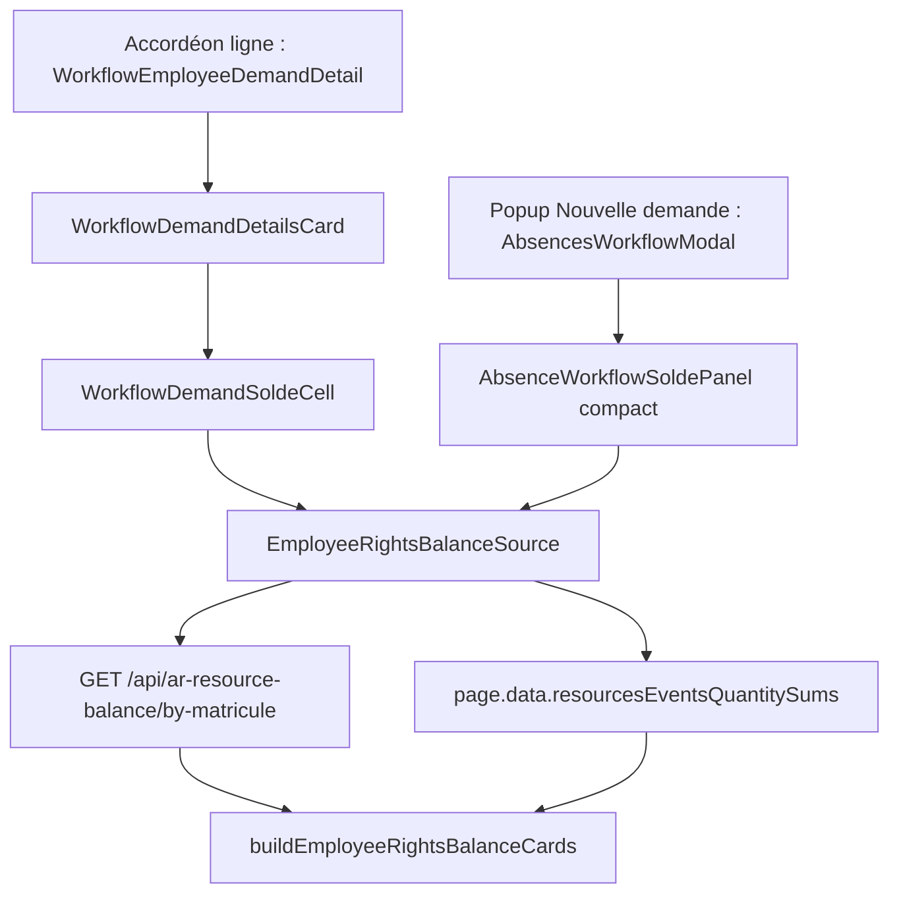

# GTA-1927 — Alimentation des soldes (onglet demandes)

Constat au 18/11/2026, limité à l’onglet collaborateur « Mes demandes » (création de workflow). Pas de correctif dans ce document : il décrit comment les deux widgets sont alimentés, si cela colle au patch de démo, et ce qui a changé.

Périmètre testé : Amélie Dupont, responsable Murielle Colbert. Demandes CP du 18/11 au 20/11, puis du 09/11 au 11/11.

## 1. Les deux widgets lisent la même source

Aucun des deux affichages ne recalcule un solde. Les deux passent par `EmployeeRightsBalanceSource`, qui charge deux jeux de données puis appelle `buildEmployeeRightsBalanceCards`.

### Accordéon d’une ligne

`EmployeeDemandsTabShell` rend `WorkflowEmployeeDemandDetail`, qui rend `WorkflowDemandDetailsCard`. La colonne Situation est `WorkflowDemandSoldeCell` : Déjà pris, À venir, puis le bandeau « solde disponible ».

Le droit affiché vient de `resolveDemandSoldeOnlyKeys`. CP, RTT ou TT seulement si l’événement porte `isRightsCalculationAssociated`.

Fichiers :

- `cronexia-gta-front-v2/app/src/routes/components/cronexia/workflow/EmployeeDemandsTabShell.svelte`
- `cronexia-gta-front-v2/app/src/routes/components/cronexia/workflow/WorkflowEmployeeDemandDetail.svelte`
- `cronexia-gta-front-v2/app/src/routes/components/cronexia/workflow/demand-details/WorkflowDemandDetailsCard.svelte`
- `cronexia-gta-front-v2/app/src/routes/components/cronexia/workflow/demand-details/WorkflowDemandSoldeCell.svelte`

### Popup « Nouvelle demande »

`WorkflowNewDemandButton` ouvre `AbsencesWorkflowModal`, qui rend `AbsenceWorkflowSoldePanel` en mode `compact` : identité du droit et bandeau de solde, sans Déjà pris ni À venir.

La clé suit l’événement choisi : `TT` donne `tt`, sinon `resolveAbsenceSoldeOnlyKeys` (CP ou RTT).

Fichiers :

- `cronexia-gta-front-v2/app/src/routes/components/cronexia/workflow/WorkflowNewDemandButton.svelte`
- `cronexia-gta-front-v2/app/src/routes/components/cronexia/workflow/AbsencesWorkflowModal.svelte`
- `cronexia-gta-front-v2/app/src/routes/components/cronexia/workflow/AbsenceWorkflowSoldePanel.svelte`

### Priorité des chiffres

Dans `employee-rights-balances.ts` :

1. S’il existe une ligne `ArResourceBalance` pour DCP ou DRTT, le solde, les droits et le pris viennent de cette ligne : `balanceInProgress + balanceAcquisition + balanceReport`, acquis cumulés, pris cumulés. Le télétravail est toujours exclu de ce chemin.
2. Sinon, repli sur les sommes d’événements de l’année civile.

Amélie Dupont n’a pas de seed de solde AR. Les seeds AR sont rattachées au matricule `123456A`. Ses 25 / 19 / 90 sont les plafonds fixes de `resources-events-quantity-sum-config.ts` : CP 25, RTT 19, TT 90. C’est le chemin de son test.

Les sommes viennent du hook `260-load-resources-events-quantity-sums` : GraphQL `resourcesEventQuantitySumByPeriod`, période = année civile courante, événements `RTT`, `CP`, `TT`. Le résultat est exposé dans `page.data.resourcesEventsQuantitySums`, puis relu par `SoldesCongesFromQuantitySums`.

Côté back, `ResourcesService.buildEventRangeOnResourceWhereForQuantitySum` (`cronexia-gta-back/app/src/resources/resources.service.ts`) :

- `totalQuantityToDate` (pris à date) : du 1er janvier à aujourd’hui (date serveur, bornée par la fin de période). Compte les `EventRangeOnResource` sans workflow, ou dont le workflow est `validated`.
- `totalQuantity` (pris prévisionnel) : toute la période. Même filtre. `WorkflowStateEnum.pending` est commenté, avec un TODO GTA-1915.

Exclus des deux totaux : `draft`, `pending`, `refused`, `cancelled`, `awaitingAttachements`.

### Formules du repli (cas Amélie)

- Déjà pris = `totalQuantityToDate`
- À venir = `totalQuantity − totalQuantityToDate` (jours validés encore dans le futur)
- Solde disponible = `max(0, plafond − pris à date)`

Le 18/11/2026, une validation du 18 au 20 donne donc Déjà pris 1, À venir 2, solde 24. Une validation du 9 au 11 ajoute 3 au pris à date : Déjà pris 4, solde 21, À venir inchangé. Cela correspond au test.

Une demande encore `pending` (ou brouillon, refusée, annulée) est absente des deux sommes : rien ne bouge, ni dans l’accordéon ni dans la popup.

L’infobulle « À venir » dit encore « Jours validés ou en attente à venir ». Le filtre back ne compte plus l’attente.

## 2. Cohérence avec le patch de démo

Les compteurs de démo ne sont pas exécutés par ces widgets. Ils restent dans :

- `cronexia-gta-back/app/prisma/seeds-new/02-recommended/counter/counter-conges-CP.seed.ts`
- `cronexia-gta-back/app/prisma/seeds-new/02-recommended/counter/counter-conges-RTT.seed.ts`
- `cronexia-gta-back/app/prisma/seeds-new/02-recommended/counter/counter-conges-TT.seed.ts`

Cinq compteurs par droit, préfixes CP / RTT / TT :

| Compteur | Rôle |
| --- | --- |
| `*DR` | Droits, constante : CP 25, RTT 19, TT 90 |
| `*PD` | Pris à date : saisie directe + validés, figé après aujourd’hui |
| `*PA` | Pris sur l’année : saisie directe + validés + `pending` |
| `*SD` | Solde à date = `*DR − *PD` |
| `*SP` | Solde prévisionnel = `*DR − *PA` |

Le bandeau actuel affiche l’équivalent de `*SD` (solde à date). Le test validé (24 puis 21) colle à `*SD`, pas à `*SP` : les 2 jours validés du 19 et du 20 ne sont pas retirés du solde. Ils restent dans « À venir » tant que leur date n’est pas atteinte.

Le patch quantity-sums a été écrit comme substitut de ces compteurs (commentaire en tête de `build-soldes-conges-from-quantity-sums.ts`), avec les mêmes plafonds. Il ne les appelle pas. Il évite une exécution de compteurs jugée coûteuse, en lisant directement les quantités d’événements.

Écart avec l’intention « le solde disponible tient compte des demandes en attente » : même dans les compteurs, ce n’est pas `*SD` qui inclut le pending, c’est `*PA`, puis `*SP`. Réactiver `pending` seulement dans `totalQuantity` ferait bouger « À venir », pas le bandeau, tant que le bandeau reste `plafond − pris à date`. Pour que le bandeau baisse dès la demande, il faudrait soustraire le pending (tout ou partie) du solde affiché. Le faire via `*SP` soustrairait aussi les jours validés futurs, ce qui contredit le test jugé cohérent (solde 24, pas 22).

## 3. Ce qui a changé

- GTA-1911 : seuls les événements au statut `validated` (ou sans workflow) entrent dans les deux totaux. Le `pending` du mode prévisionnel est commenté (TODO GTA-1915). Les seeds `*PA` incluent encore `validated + pending`, mais les widgets ne passent plus par `CounterExecution`.
- Le bandeau « solde disponible » des cartes droits est le solde à date. Le donut historique aliasait le solde prévisionnel (`solde: soldePrevisionnel` dans `buildSoldeCongeVisuMetrics`).
- Dès qu’une ligne `ArResourceBalance` existe, elle gagne sur les sommes d’événements pour le solde, les droits et le pris. Cas Maxime : CP 32,33 vient de cette ligne, pas du plafond 25. Ces lignes ne sont pas recalculées par la validation d’une demande. Le télétravail n’a pas de ligne AR : il reste sur le plafond 90 et les sommes d’événements. Les deux widgets partagent cette règle, donc le décalage vaut pour l’accordéon et pour la popup. La répartition Déjà pris / À venir, elle, continue de venir des sommes d’événements même quand le solde vient de l’AR.

## 4. Dates : l’année civile courante, pas une constante 2026

Le widget n’est pas figé sur 2026. `getCalendarYearPeriod()` prend l’année de la date du jour.

Le 18/11/2026, concrètement :

- Requête des sommes : `2026-01-01` → `2026-12-31`.
- Pris à date : `2026-01-01` → aujourd’hui serveur inclus (`min(fin de période, new Date())`), donc jusqu’au `2026-11-18`. Le 18 compte dans Déjà pris.
- Libellé de période du repli : `01/01/2026 – 31/12/2026`.

Les compteurs de démo, eux, sont figés : `dateStartLimit` / `dateEndLimit` = `2026-01-01` / `2026-12-31` pour CP, RTT et TT. Les constantes de droits (25, 19, 90) sont datées du 01/01/2026 dans les libellés de seeds.

Si une ligne AR est utilisée, la période affichée est celle de l’exercice (`takeStartDate` → `takeEndDate`), qui peut chevaucher deux années civiles. Ce n’est pas le cas d’Amélie.

## 5. Lecture du test

| Étape | Déjà pris | À venir | Solde disponible | Lecture |
| --- | --- | --- | --- | --- |
| Demande CP 18/11–20/11, non validée | inchangé | inchangé | 25 | `pending` exclu des deux totaux |
| Validée par Murielle | 1 | 2 | 24 | seul le 18/11 est ≤ aujourd’hui |
| Demande CP 09/11–11/11, non validée | 1 | 2 | 24 | même exclusion |
| Validée | 4 | 2 | 21 | +3 jours déjà passés sur le pris à date |

Le solde disponible affiché est le plafond moins les jours validés dont la date est passée ou égale à aujourd’hui. Il ne réserve pas les jours validés à venir, et il ne réserve pas les demandes en attente.
